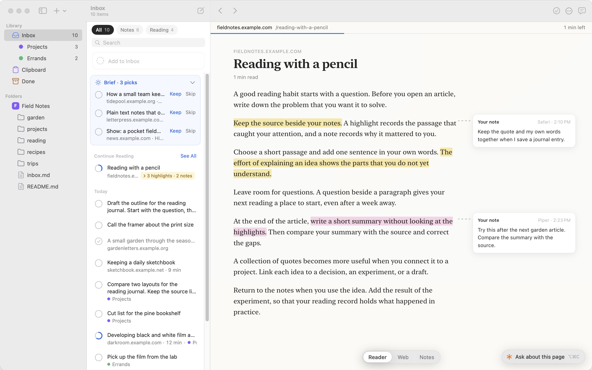
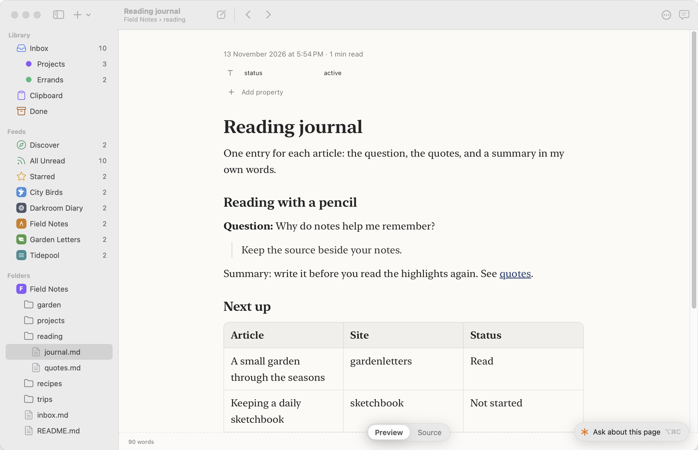
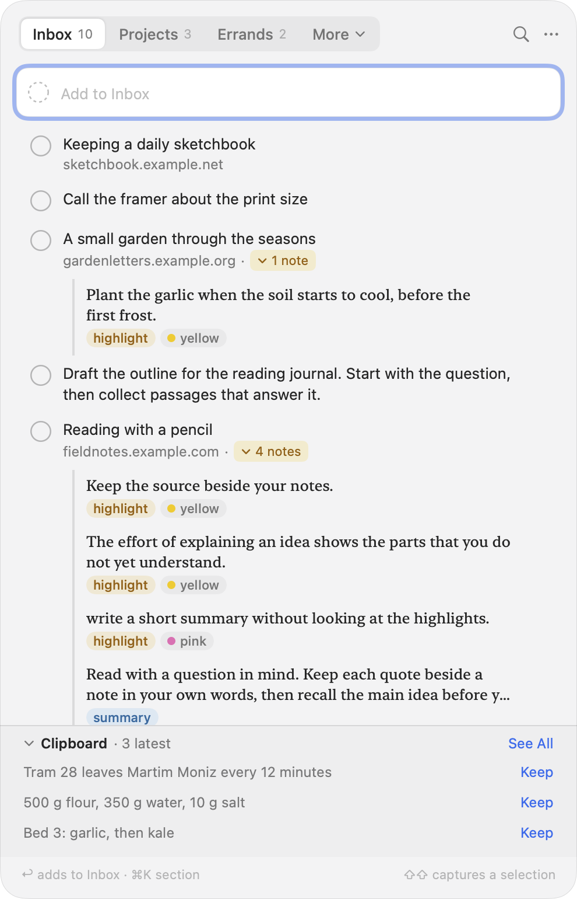
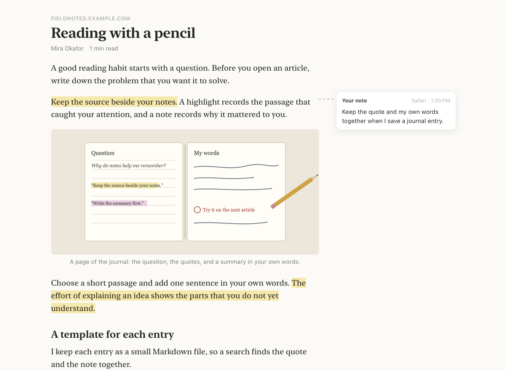
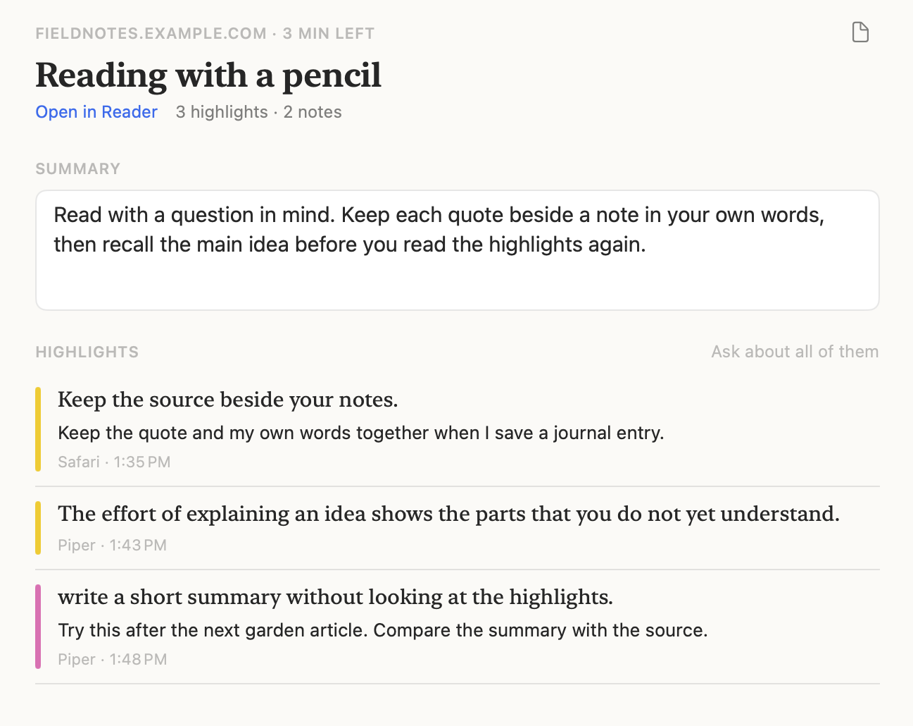
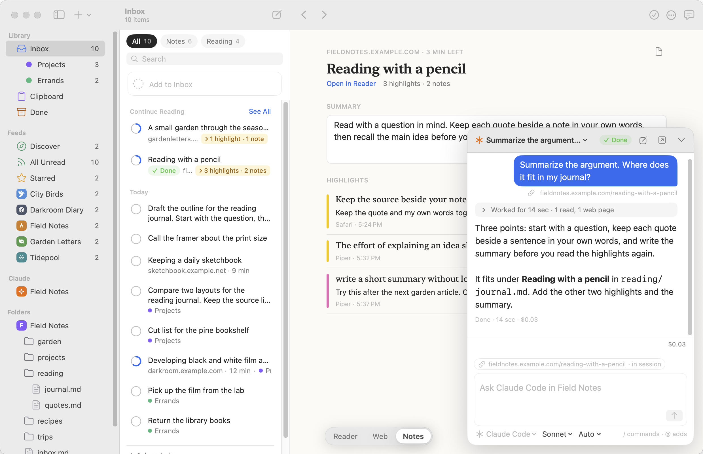

# Piper

Piper is a native macOS application for capturing text. It saves selected text and clipboard entries as local notes in a floating panel beside the application you work in. A separate window browses and edits a folder of files, such as a Markdown wiki.

Capture and browsing need no account, cloud service, telemetry, or network connection. Notes stay in a local SQLite database. Wiki files stay on disk as they are. The web reader connects to the pages you open.



The screenshots use fictional articles, notes, and conversations in an isolated local database.

## Status

Piper is an early preview at version 0.1.1. Each release has a signed and notarized DMG for Apple silicon. To run the current source, build it with the steps in [Quick Start](#quick-start).

Selection capture works, but its compatibility across applications is unverified. The Markdown editor opens footnotes, link titles, and table alignment as read-only. Piper captures text only. The [capability status](docs/release/status.md) page records each feature and its evidence.

The [release checklist](docs/release/readiness.md) tracks the remaining acceptance and distribution checks.

## Download

1. Download `Piper_<version>_arm64.dmg` from the [latest release](https://github.com/sonnes/piper/releases/latest).
2. Open the DMG and drag Piper to Applications.
3. Open Piper from Applications.

The DMG requires macOS 14 or later on Apple silicon. On an Intel Mac, build Piper from source.

## Requirements

To build Piper from source, you need:

- macOS 15.6 or later
- Xcode 26 or later, for the macOS 26 SDK
- Make

The app that you build runs on macOS 14 or later.

## Quick Start

1. Clone the repository and build the app:

   ```sh
   git clone https://github.com/sonnes/piper.git
   cd piper
   make run
   ```

2. Type a note in the capture panel and press Return.
3. Copy text in another app. Click its card in the panel to save it to Inbox.
4. Press Command-2 to open the main window on `~/Desktop/Wiki`.

To add another folder, select Add Folder in the + menu of the main window toolbar. To capture a selection with Shift pressed twice, allow Accessibility access first. See [Install Piper](docs/guides/install.md).

## Windows

| Window | Purpose |
| --- | --- |
| Capture panel | Save, organize, edit, and copy notes |
| Main window | Search, read, preview, and edit files, and read captures in Inbox |
| Note editor | Edit one capture in a separate window with Save |
| Settings | Folders, the capture shortcut, and reading preferences |

The capture panel and the main window take turns on screen. Command-1 shows the panel, and Command-2 shows the main window. Neither closes, so a draft stays open.

Both windows use the system font and colors, with one blue accent. Both follow the system appearance.

The sidebar of the main window shows Inbox, the clipboard history, and your folders. A folder opens as a tree, and each file shows its extension. Inbox lists your captures, with the picks of the [daily brief](docs/guides/brief.md) at the top.





## Highlights And Notes

The Reader tab shows the text of an article with its images, videos, code blocks, and tables. Highlights show in the text, and your notes show beside them. The Notes tab collects the summary, the highlights, and the notes of the article. Piper opens each site in the tab that you chose last for it.





See [Highlight and ask in the Reader tab](docs/guides/browse.md#highlight-and-ask-in-the-reader-tab) for the controls.

## Claude Sessions

Piper talks to Claude Code in a session card beside the open file or capture. The next message takes the file or the link on the screen as context, and `@` adds other files and captures. The card shows tool activity, permission requests, and questions. Claude Code requires a separate installation and authentication. Text that you send to Claude leaves local storage for processing through Claude Code.

See [Work with agents](docs/guides/claude.md) for setup, ACP agents, and permission controls.



## Documentation

- [Documentation overview](docs/README.md)
- [Capture notes](docs/guides/capture.md)
- [Browse and edit files](docs/guides/browse.md)
- [Keyboard shortcuts](docs/guides/shortcuts.md)
- [Architecture](docs/internals/architecture.md)

## Development

| Command | Result |
| --- | --- |
| `make build` | Build and sign the local application bundle |
| `make run` | Build and open the application |
| `make test` | Run the Swift test suite |
| `make release` | Test, build, sign, notarize, and validate a DMG for the architecture of the build Mac |

`make release` reads Developer ID credentials from a local `.envrc` file, which Git ignores. [Build a signed release](docs/guides/install.md#build-a-signed-release) lists the variables.

`Sources/Modules/` holds the model modules, and `Sources/Piper/` holds the application. `Sources/CSQLite/` exposes system SQLite. Each module has a test target in `Tests/`. See [Architecture](docs/internals/architecture.md) and [Coding guidelines](docs/internals/coding-guidelines.md).

`Resources/AppIcon.png` is the icon master. The build creates `Resources/Piper.icns` and bundles the fonts, the bird mark, and the licenses.

## License

Piper is licensed under the [Apache License 2.0](LICENSE).

The application bundles the components below. Their license texts are in [`Licenses/`](Licenses/) and ship inside the application bundle.

| Component | License |
| --- | --- |
| [Yams](https://github.com/jpsim/Yams) | MIT |
| [libyaml](https://github.com/yaml/libyaml), vendored in Yams | MIT |
| [Hubble.md](https://github.com/bholmesdev/hubble.md), the Markdown editor | MIT |
| The packages of the editor page, such as Tiptap, ProseMirror, React, and remark. `Licenses/Editor.txt` lists each one. | MIT, ISC, Apache 2.0, and others |
| [IBM Plex Mono](https://github.com/IBM/plex) | SIL Open Font License 1.1 |
| [Lucide](https://lucide.dev) 1.49.0, sidebar icons | ISC |

## Attribution

The initial idea for Piper came from [Copper](https://shadcn.com/copper) by shadcn.

Piper adapts its coding guidelines, window architecture, and interface values from [NetNewsWire](https://github.com/Ranchero-Software/NetNewsWire), by Brent Simmons and the NetNewsWire contributors. NetNewsWire is Copyright (c) 2002-2025 Brent Simmons and uses the MIT license. Piper ships no NetNewsWire code. The license text is in [`Licenses/NetNewsWire.txt`](Licenses/NetNewsWire.txt).
