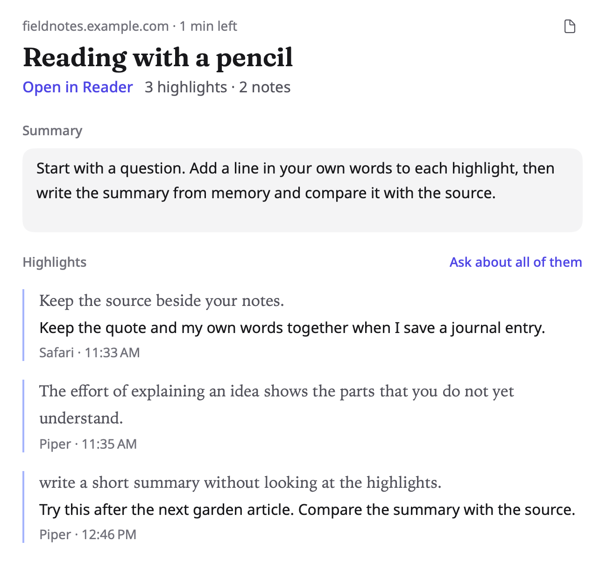

# Browse And Edit Files

Piper shows your captures, your feeds, and your folders on papers. A paper is a window with round corners and no title bar. The feed paper lists the items. Each item that you open shows on a reader paper of its own.

Piper keeps one or more folders. The folder that you work in is the active folder. Any folder works: Piper needs no index, no frontmatter, and no folder names. See [Wiki files](../concepts/files.md) for the scan rules.

To open the feed paper, press Command-0, or select Feed Paper in the menu bar icon. Command-1 opens it on Today. Command-2 opens it on Feeds.

## Add A Folder

The default folder is `~/Desktop/Wiki`. Each folder that you add gets a tab on the feed paper.

1. Open the feed paper with Command-0.
2. Select the dashed + Folder tab at the end of the column of tabs.
3. Select one or more folders.
4. Select Add.

The feed paper then shows the tab of the first new folder. Add Folder is also in the More menu of the feed paper and in Settings > General.

Piper keeps the added folders across restarts. To make a folder the active folder, select its tab.

To remove a folder from Piper, Control-click its tab and select Remove Folder. Remove Folder is also in the More menu while the tab of a folder is active, and in Settings > General. The folder on disk does not change. You cannot remove the last folder.

[Go to File](#go-to-a-file) searches the active folder. Before Piper changes the folder, it saves the open file. If the open file has a conflict, Piper stays in the current folder.

## Find Your Way Around

The feed paper has a column of tabs on its left edge. Each tab looks like a file-folder tab on its side, in its own pastel color. The label reads from bottom to top, and a count follows the name:

| Tab | Color | Count | Index |
| --- | --- | --- | --- |
| Today | Indigo | The captures that are not done | All, Notes, Reading, Kept, each section, Done, and New Section. See [Capture notes](capture.md#today). |
| Feeds | Sky | The unread articles of all feeds | Sources, then each feed with its unread articles. See [Read feeds](feeds.md#browse-your-feeds). |
| Agents | Plum | The sessions that wait for you | Each folder that has sessions. See [Find a session](claude.md#find-a-session). |
| A folder | Teal, rose, clay, or emerald | The files in the folder | None. The tab shows the tree of the folder. |

The Agents tab shows only while a folder has sessions. A count over 999 shows as 999+.

The folder tabs come after the fixed tabs, in the order that you added the folders. The label of a folder tab is the name of the folder. Piper scans only the active folder, so the count on another folder tab is the count of its last scan.

Each tab lies under the tab above it. The active tab comes to the front, takes the color of the paper, and joins the paper. A line in the color of the tab stays on its outer edge. If Reduce Motion is off, the active tab slides out from under the paper. The dashed + Folder tab at the end of the column adds a folder.

If the column is taller than the paper, each folder tab shows only the first letter of its folder. Move the pointer over a short tab to see the name of the folder. To show the full names again, make the paper taller.

### Move Between The Index And The List

The feed paper shows the index of a tab or the list of one scope. A scope is one item of an index, for example one section or one folder.

1. Select a tab. The paper shows the index of the tab.
2. Select an item on the index. The paper shows its list.

The folder tabs have no index. A click on a folder tab shows its tree at once.

To go back to the list, press Escape, select Back to the List, or select the active tab again. To see the index again, select the active tab. If Reduce Motion is off, the index and the list fade into each other in 0.22 seconds.

These keys work while the feed paper has the focus and no text field is active:

- To show a tab, press Command and its number, from 1 to 9. The numbers follow the order of the column.
- To open the index of the active tab, press Left Arrow, or Command and the number of the tab.
- On the index, press Up Arrow or Down Arrow to move the cursor. A ring marks the row of the cursor.
- To show the scope at the cursor, press Return or Right Arrow.
- To show the previous or the next scope of the tab, press `[` or `]`.

If the active tab shows a scope other than its first scope, Command and its number show the first scope. A second press opens the index. In Today, the keys 1 to 4 without Command choose a lens.

A hairline parts two rows of a list. The selected row has an indigo fill while the feed paper has the focus, and a gray fill when it does not. Group headers, such as Today, stay at the top of the list while it scrolls.

In Today, the selected row and the row under the pointer show Keep, Done, File, Send, and a More menu in place of the time. See [Act on a row](capture.md#act-on-a-row). In the list of one feed, the row under the pointer shows Mark as Read or Mark as Unread.

The title of the list names the tab and the scope, for example "Today › Sources". The More menu at the top right has New Capture, New Section, Add Folder, Sources, Show in Finder, Refresh, and Settings. While the tab of a folder is active, the menu also has Remove Folder.

### Open An Item On A Paper

Select a row in a list to open the item on a reader paper. If the session card is in the detached panel, a session opens in that panel. The paper opens to the right of the feed paper, in the first free place of a cascade. Each place of the cascade is 24 points to the right of and lower than the place before it. A new paper has the size of the last paper of its kind that you moved or resized. The three kinds are reader papers (articles, links, and files), notes, and agent sessions. If you moved or resized the paper of an item before, its paper opens in that frame. If the item is already open, Piper brings its paper to the front.

A capture, an article, a file, and a session each open on a paper. One file paper shows all files: a second file replaces the first file on the same paper.

The header of a reader paper names the item at the left. A toolbar at the right holds the actions of the item as symbols. Move the pointer over a symbol to see its name and its key.

| Item | Header | Toolbar |
| --- | --- | --- |
| A note | The section, the source app, and the time | Put Back |
| A link | The site and the reading time | Mark as Done or Open Again, and Put Back |
| An article | The site icon, the feed, and the time | Keep and Put Back |
| A file | The folder, the folders of the file, and the file name | Back, Forward, and Put Back |
| A session | The title of the session and its state | Put Back |

Put Back is the x at the end of each toolbar. The foot of a note paper says "Saved as you type" and has Mark as Done or Open Again.

The paper with the focus has a deep shadow. Each other reader paper tilts a little, and its content fades. The row of an open item shows a dashed outline and "on the desk" in place of its time. When the paper goes back, the row flashes.

To close a reader paper, press Escape or Command-W, or select Put Back. To move the focus to the next paper, press Command-`. To put each reader paper back in its place of the cascade, press T.

### Move And Resize A Paper

- To move a paper, drag its header. On a note paper, you can also drag its foot.
- To change the size of a paper, drag one of its edges or corners. The pointer changes to a resize pointer at the edge.
- To zoom a paper, double-click its header. The paper fills the screen. Double-click the header again to put the paper back.

A double-click on the header obeys the setting "Double-click a window's title bar to" in System Settings > Desktop & Dock. If the setting is Minimize, the paper goes to the Dock. If the setting is Do Nothing, the paper stays.

A reader paper is at least 420 points wide. The feed paper is at least as wide as the column of tabs and a list. A paper is never larger than the screen.

Piper keeps the frame of the feed paper and the frame of each reader paper across restarts. If you disconnect a display, each paper moves onto a screen that is still connected.

While Piper is active, a strip at the bottom of the screen shows the keys for the paper with the focus.

### Use The Folder Tree

The tab of a folder shows a tree of its folders and files, with the folder name as the title. Folders come first, then files. Each file and each folder shows its full name, with the extension. A folder shows the number of files in it. A file shows the date of its last change.

- To open or close a folder, select it.
- To open a file on the file paper, select it.

These keys work on the tree while the feed paper has the focus:

| Key | Action |
| --- | --- |
| Up Arrow, Down Arrow | Move the cursor through the rows that show |
| Right Arrow | Open a closed folder. On an open folder, move to its first row. |
| Left Arrow | Close an open folder. On another row, move to its folder. |
| Return | Open a file, or open or close a folder |

Piper keeps the open folders of each tree across restarts.

### Change The Color Of A Folder Tab

Each new folder gets the next color of teal, rose, clay, and emerald. When each of these colors is in use, the colors start again at teal.

1. Select the tab of the folder.
2. Select a swatch in the Tab color row under the title.

Piper keeps the color of each folder.

The feed paper restores its frame, its tab, its scope, the open folders, the tab colors, and the last file.

## Search Today

Press Command-F to show the search field at the top of Today. Search matches the notes, the links, the articles, and their highlights in every section. In Done, search matches only completed notes.

To find a file, use [Go to File](#go-to-a-file).

## Read A File

Select a file in the folder tree. The file opens on the file paper.

A Markdown file opens in the editor, in a centered column. The page uses the paper, the type, and the colors of the Reader tab. A byline over the text shows the modification date and the reading time. After a save, the byline also shows "Saved". The byline scrolls with the text. If the file has no heading, its title shows under the byline.

An image line, such as ``, shows the image. The path starts at the folder of the file, or at the vault root when it starts with `/`. An image with an HTTP or HTTPS address loads from the web.

Wiki links use `[[Note]]`, `[[folder/Note|Label]]`, and `[[Note#Heading]]`. Relative Markdown links open from the current file. HTTP, HTTPS, and `mailto` links open in your default app. To follow a link while you edit, Command-click it.

To ask an agent about the open file, press Option-Command-C while its paper has the focus. See [Talk to an agent in a session](claude.md#talk-to-an-agent-in-a-session).

Use Command-[ and Command-] to go back and forward. To scan the folder again, press Command-R, or select Refresh in the More menu.

## Change Reading Preferences

Open Settings with Command-comma, then select Reading. The preferences change how Piper shows a Markdown file. They do not change the file.

| Preference | Values | Default |
| --- | --- | --- |
| Font | Mono, Serif, Sans | Serif |
| Size | 13 to 24 points | 18 points |
| Paper | Paper, Sepia, Slate | Paper |
| Appearance | System, Light, Dark | System |

Serif is New York, the serif of macOS. Mono is IBM Plex Mono. Paper is the background color of the Reader tab. Reset to Defaults restores the defaults.

## Preview Other Files

Piper opens every file in the vault, not only Markdown.

- HTML, RTF, images, PDFs, and other rich files use the macOS Quick Look preview.
- JSON, plain text, source code, and other text files show as read-only monospaced text.
- Open in Default App opens the file in another app. The folder button reveals the file in Finder.

A file larger than 4 MiB, or a file that is not UTF-8 text, uses the Quick Look preview. Piper cannot edit it, even if it is Markdown.

## View The Source

For a Markdown or HTML file, select Source in the tabs at the bottom of the paper. The choice stays for the next file. Select Preview to go back to the formatted page.

For Markdown, Source is an editor for the raw text of the file, including the frontmatter. Piper saves an edit in Source the same way as an edit in Preview. For HTML, Preview shows the page and Source shows its markup as read-only text. The control is off for a file that has no source text.

## Edit A Markdown File

1. Select a Markdown file.
2. Type in the page.

Piper saves the file 120 ms after you stop typing. The file needs no Save command. Command-S saves at once.

The editor is the editor of [Hubble.md](https://github.com/bholmesdev/hubble.md). Formatting shows as you type:

- Markdown shortcuts work, for example `# ` for a heading, `- ` for a list, and `**` for bold.
- A `/` at the start of a line opens a list of blocks: headings, lists, a to-do list, a quote, a divider, and a table.
- Command-K makes a link from the selected text. Type `[[` to link to another file.
- Command-Z reverses an edit.
- A footnote shows as a small number in the text. Its note shows at the place of `[^label]: text` in the file. To add a footnote, type `[^1]` after a word. Then type `[^1]: ` and the note at the start of a line.

A file with frontmatter shows its keys as properties over the text. You can change a value, change the type of a key, or select Add Property. If the YAML is not valid, the properties show as read-only text.

A save writes the text of the editor. The editor changes some Markdown to one form. For example, `*` bullets become `-`, and `__bold__` becomes `**bold**`. The text, the links, and the frontmatter do not change.

### Highlight And Ask In A File

Select text in a file to show the selection bar. It is the bar of the Reader tab, with Bold, Italic, and Link at the end. See [Highlight and ask in the Reader tab](#highlight-and-ask-in-the-reader-tab).

- Highlight writes `==text==` into the file. To remove the highlight, select the text and select Highlight again. A green or pink highlight from an older version stays `<mark class="green">text</mark>` or `<mark class="pink">text</mark>`.
- Note writes a highlight into the file, and keeps your note in Piper. The note shows as a card in the margin.
- Ask, Explain, and Define send the selection to the margin agent. The answer shows as a card in the margin, and Piper keeps it. The file does not change. A dashed line marks the text of each question.
- Capture saves the selection as a new capture in Inbox.

Piper keeps the notes and the answers of a file under one capture, with the address `piper-file://` and the path of the file. If you rename or move the file, its cards do not follow it.

If the paper is too narrow for the margin, the cards show under the text. In a read-only Preview, the bar has no Highlight, no Note highlight, and no formatting.

### When Preview Is Read-Only

Some Markdown has no place in the editor, for example link titles and table alignment. A save from Preview would remove it. For such a file, Preview is read-only, and a bar over the page names the syntax. To edit the file, select Edit in Source.

### When The File Changes On Disk

An agent or another app can write a file while it is open in Piper.

- If you have no edits that are not saved, the page shows the new text.
- If you have such edits, Piper stops saving the file, and a bar shows over the page. If a Claude session of Piper wrote the file, the bar says so.

In the bar, select one of these:

- Reload shows the text on disk and removes your edits.
- Keep Mine writes your text over the change on disk.

Piper does not change the folder or quit while a file has this bar. It shows the file, so you can choose.

## Find Text In A File

1. Press Command-F.
2. Type the text.
3. Press Return for the next match.

The find bar also replaces text. Press Escape to close it.

## Go To A File

1. Press Command-K, or select Go > Go to File.
2. Type a part of the file name or the title.
3. Use Up and Down to select a row, then press Return.

With an empty field, the palette lists the files that you opened last. With 3 characters or more, it also lists lines in files that hold the text. Type `/` to list commands, such as Find in File and Refresh. The commands that you ran last show first. Press Escape to close the palette.

## Add An Image Or An HTML File

To add an image, paste it or drag it into the page. Piper saves the image in a folder next to the note, `<note name>.assets`, and adds a link to it.

To show an HTML file of the folder in a note, add a line like this:

```html
<iframe src="./chart.html"></iframe>
```

The page shows the HTML file in a frame. Piper reloads the frame when the file changes. The frame cannot read or change other files, and its links do not open.

## Read Captures

Today shows your captures with the new articles of your feeds. See [Capture notes](capture.md#today) for the lenses, the groups, and the actions on a row. Select a section on the Today index to show only its captures.

Each row shows its time at the right. Every list title uses Noto Sans. A note shows its text, and under it the source app and the section. A link shows the first line of its title. Under the title, it shows the site, the reading time, the progress, and the section.

A note has a circle. Select the circle to mark the note as done. A done note shows an indigo circle with a check, and a line goes through its text. A link and an article show the icon of the site, with an indigo dot until you open the item.

The last two notes of a capture show under its row, with the quoted text. A line under them gives the number of the other notes. Select a note to open it. When a new note lands under a row, the row flashes.

Select a capture, then press Return or click it again, to open it on a reader paper. You can also select it and press Return. Type in the text to change the note. Piper saves the change shortly after you stop typing. If the note looks like source code, the text uses a monospaced font. The editor does not change quotes or dashes while you type. The source app shows under the text.

A capture that holds only a web link opens in the tab that you last chose for its site, Reader or Web. A link from a new site opens in the Web tab. A click on one of its highlights or questions opens the Reader tab at that text. Its agent session, if it has one, shows in the session card. A note that holds a link and more text opens in the editor. To read its link, Control-click the note and select Add Link to Reading.

The tabs at the bottom of the paper show Reader, Web, and Notes for a capture with a link. The Reader tab shows the article as clean text, with the site, the title, and the reading time. It keeps the images with their captions, the videos, the code blocks, and the tables of the page. A YouTube, Vimeo, Loom, or Wistia video shows as its still image. Select it to watch the video in your browser. Notes and answers show under their passage. The Web tab shows the original page. The Notes tab shows the notes of the article. If Piper cannot find the article text, select Show Web Page.

While the article loads, the Reader tab shows the site, the title when Piper knows it, and gray lines in the place of the text. If the page takes more than five seconds, a line says that the page is slow. When the text arrives, it moves into place. If Reduce Motion is on in the Accessibility settings of macOS, nothing moves.

The row of the article in the list shows the reading time and the progress. Piper saves your place when you stop scrolling. The next time, the article opens at that place, and a line over the article says so. To go to the title, select Start from the top. An article that you highlighted in a browser, and did not open in Piper, opens at your newest highlight.

### Highlight And Ask In The Reader Tab


Select text in the article to show the selection bar. The bar has Highlight and Note, then Ask, Explain, Define, and Capture.

- To mark the text, select Highlight or press H. The highlight is indigo. Green and pink highlights from older versions keep their color.
- To get an explanation, select Explain.
- To get the meaning of a word or a phrase, select Define.
- To ask your own question, select Ask or press Command-K. Type the question, then press Return.
- To write your own note, select Note or press N. A note field opens under the passage. Type the note, then press Return. Piper saves a highlight with the note. Escape closes the field and keeps the highlight.
- To save the selection as a new capture in Inbox, select Capture.

Ask, Explain, and Define send the selection to the margin agent. By default, the margin agent is Claude Code with Haiku. To change the agent or the model, open Settings > AI > Defaults.

The first question about a capture also sends the article text. One hidden session answers every question about one capture. The Agents tab does not show this session.

The margin agent works in the folder of the Send buttons. It can read the files of that folder and search the web. It cannot change a file or run a command, so it never asks for your approval. Claude Code gets only the Read, Grep, Glob, WebSearch, and WebFetch tools, and no MCP server. For an ACP agent, Piper uses the read-only mode of the agent, such as Plan. Piper also allows each request that only reads, and denies each other request. An ACP agent without a read-only mode cannot answer in the margin. See [Choose the agent, the model, and the mode](claude.md#choose-the-agent-the-model-and-the-mode).

Your notes show under their passage, with the app and the time. Up Arrow and Down Arrow scroll the article, also while the list has the focus. To move to the next or the previous mark, press Option-Down Arrow or Option-Up Arrow.

The answer shows as a card under the passage, and the text of the question is underlined. The card names the model and the agent. If the answer used tools, a line under the answer names them, for example "Used 2 reads, 1 search". To ask a follow-up question, type in the card and press Return. To hide a card, select its close button. To show the card again, select the underlined text.

To continue with an agent that can change files, select Continue in Session on the card. Piper opens a draft session with the question thread and the address of the page. The agent starts only after you send the draft.

Each highlight and each question is a note under the link capture. In the list, these notes show under the capture with their tags: highlight and a color, or question. Select a note in the list to scroll the Reader tab to its text. To add a tag, Control-click the note and choose Add Tag. When you delete the capture, Piper also deletes its notes.

Each note keeps the quoted text and its place in the article. If the article text changes, Piper looks for the quote in the same paragraph first, then in the whole article. If the quote is gone, the note stays in the list and the article shows no mark.

### Use The Web Tab

The reader bar has these controls: Note, Back, Forward, the address with Reload, Capture, and Open in Browser. If a page fails to load, select Try Again.

To save part of a page as a new capture:

1. Select text on the page.
2. Select Capture in the reader bar.

If no text is selected, Capture saves the whole page text. The new capture goes to Inbox with the page title and URL. The original capture does not change.

Piper loads HTTP and HTTPS pages only. A page needs a network connection.

## Keep A Reading List

Select the Reading lens in Today, or press 3. Reading shows each capture that holds only a web link, and each page that you saved from a browser.

| Group | Articles |
| --- | --- |
| Continue | The articles that you opened or highlighted. The newest activity is first. |
| Up Next | The articles that you did not open |
| Finished This Week | The articles that you read to the end in the last seven days |

The count of the Reading row includes all three groups. When you scroll to the end of an article, or select its dot, Piper moves it to Finished This Week. Seven days later, Piper marks it as done, and it moves to Done. Piper makes this check at launch and each time the feed paper becomes active.

### Use The Notes Tab



Select Notes in the tabs at the bottom of the paper. The Notes tab shows one page for the article:

- The summary. Type it in the box. Piper saves it as a note under the article, with the tag `summary`.
- Each highlight with your note, the app where you made it, and the time. Select a highlight to open the Reader tab at its text.
- Each question to the margin agent, with the last answer.

Ask about all of them sends each highlight and note to the margin agent of the article. The answer shows under Questions.

### Save The Notes As A File

1. In the Notes tab, select the file button, Save as File.
2. Choose a folder.
3. Choose the parts: the highlights and your notes, the summary, and the agent answers.
4. Select Save.

Piper writes one Markdown file in the folder. The front matter holds the `source` URL, the `title`, and the `read` date. If a file with the same name exists, the new file gets a number.

After the save, the button shows the number of highlights that are new or changed. To add them to the end of the file, select Update File. Piper writes them under a heading with the date. Piper does not change the file until you select Update File.

For all shortcuts, see [Keyboard shortcuts](shortcuts.md).
