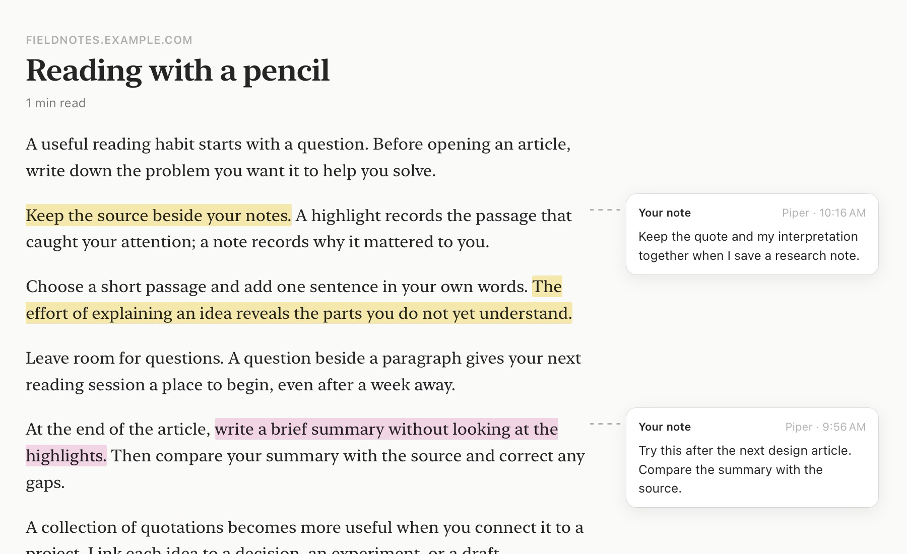
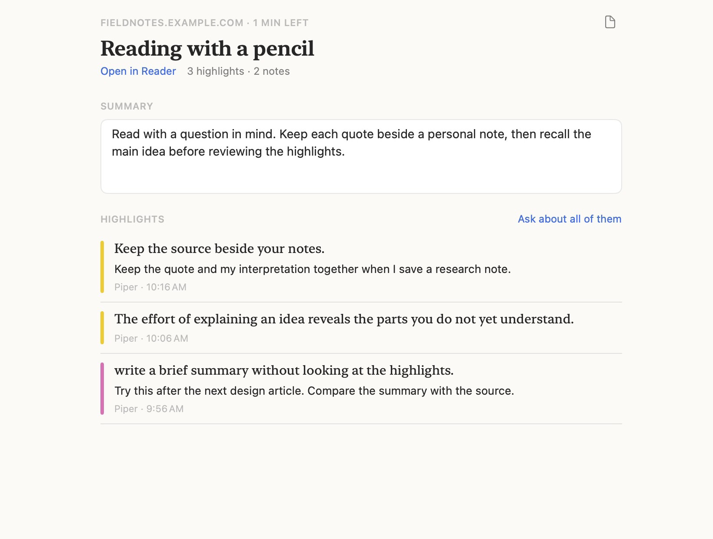

# Browse And Edit Files

The main window keeps one or more folders in the sidebar. The selected folder is the active vault. Any folder works: Piper needs no index, no frontmatter, and no folder names. See [Wiki files](../concepts/files.md) for the scan rules.

Open the window with Command-2. Command-0 opens it on the Home page.

## Add A Folder

The default folder is `~/Desktop/Wiki`.

1. Open the main window with Command-2.
2. Select Add Folder in the + menu of the toolbar, above the sidebar.
3. Select one or more folders.
4. Select Add.

Add Folder is also in the sidebar context menu and in Settings > General. When the pointer is on the sidebar, a + button also shows beside the Folders heading.

Piper keeps the added folders across restarts. Select a folder in the sidebar to show its folder tree.

To take a folder out of the sidebar, Control-click it and select Remove Folder. You can also select it in Settings > General and select the minus button. The folder on disk does not change. The last folder cannot be removed.

Home search uses the selected folder. Switching folders clears the previous search and asks you to resolve unsaved edits.

## Find Your Way Around

The window has three panes:

| Pane | Content |
| --- | --- |
| Sidebar | Library (Home, Inbox with a row for each other section, Clipboard, and Archived) and Folders (every folder, and the tree of the active folder) |
| List | The files of the selected folder, the captures, or the clipboard history |
| Detail | The selected file, Home, or the selected capture |

The window title names the sidebar selection. The subtitle shows a count, or the folder path on Home.

The toolbar has these controls:

| Control | Action |
| --- | --- |
| Toggle Sidebar | Hides or shows the sidebar |
| + | New Section and Add Folder |
| New Capture | Moves the focus to the note composer in the main window |
| Back and Forward | Moves through the files you opened |
| Mark as Done | Marks the selected capture as done, or opens it again |
| More | Reveal in Finder, Refresh, and Settings |

Tabs float over the bottom of the detail pane. A Markdown or HTML file has Preview and Source. A capture with a link has Reader, Web, and Notes.

The folder tree shows every folder and every file, as in an editor. Folders come first, then files. A Markdown file shows its name without `.md`. Each top-level folder shows a colored tile with the first letter of its name. The arrows that open and close folders show only when the pointer is on the sidebar. The arrow keys open and close folders at all times.

- Select a folder to show its files in the list.
- Select a file to open it. The list closes, and the file takes its width.

When a link opens another file, the tree selects that file and opens the folders above it.

Home hides the list. The window restores its frame, the pane widths, the selection, the open folders, and the last file.

## Search From Home

Home has one search field and a list of the six most recent files.

1. Press Command-0, or select Home in the sidebar.
2. Type text.
3. Use the Up and Down keys to select a result.
4. Press Return.

Plain text lists files that match by name, then files that match by text. Then it lists matching app actions. If nothing matches, the last row searches every file for the text.

Type `>` to list app actions: New Capture, Browse Files, Add Folder, Reveal in Finder, Capture Clipboard, and Settings.

## Search The Current List

The search field sits at the top of the list. In a folder, the sort menu sits next to it.

File search filters only the files in the selected folder. Each word must match a title, a path, a description, or the body text. Selecting another folder clears the file search.

In Inbox, search filters the notes of every section. In Clipboard, search filters the clipboard history.

Home searches the whole vault. Its Search All Files action opens an All Files list with the same search field. A leading `>` selects actions only in Home.

## Track Unread Files

A file you have not opened has a blue dot. A file becomes unread again when its modification time changes. A save that you make in Piper keeps the file read.

The window subtitle shows the number of files and the number of unread files in the folder. Sidebar counts include unread files in subfolders. A folder with no unread files shows no count. Read state is separate for each folder and survives a restart.

## Read A File

Select a file in the list. The sort menu next to the search field sorts by Name or by Date.

A Markdown file opens in the editor, in a centered column. The page uses the paper, the serif type, and the colors of the Reader tab. A byline over the text shows the modification date and the reading time. After a change that is not saved, the byline also shows "Edited" and a Save button. The byline scrolls with the text. If the file has no heading, its title shows under the byline.

A standalone image line, such as ``, shows the image. The path starts at the folder of the file, or at the vault root when it starts with `/`. Piper does not load remote images.

Text between `==` marks, such as `==key point==`, shows with a yellow highlight. A footnote reference, such as `[^1]`, shows as small raised text.

Wiki links use `[[Note]]`, `[[folder/Note|Label]]`, and `[[Note#Heading]]`. Relative Markdown links open from the current file. HTTP, HTTPS, and `mailto` links open in your default app.

To ask an agent about the open file, press Option-Command-C. See [Talk to an agent in a session](claude.md#talk-to-an-agent-in-a-session).

Use Command-[ and Command-] to go back and forward. To scan the folder again, press Command-R, or select Refresh in the More menu.

## Change Reading Preferences

Open Settings with Command-comma, then select Reading. The preferences change how Piper shows a Markdown file. They do not change the file.

| Preference | Values | Default |
| --- | --- | --- |
| Font | Mono, Serif, Sans | Serif |
| Size | 13 to 24 points | 18 points |
| Paper | Paper, Sepia, Slate | Paper |
| Appearance | System, Light, Dark | System |

Serif is Georgia. Paper is the background color of the Reader tab. Reset to Defaults restores the defaults.

## Preview Other Files

Piper opens every file in the vault, not only Markdown.

- HTML, RTF, images, PDFs, and other rich files use the macOS Quick Look preview.
- JSON, plain text, source code, and other text files show as read-only monospaced text.
- Open in Default App opens the file in another app. The folder button reveals the file in Finder.

A file larger than 4 MiB, or a file that is not UTF-8 text, uses the Quick Look preview. Piper cannot edit it, even if it is Markdown.

## View The Source

For a Markdown or HTML file, select Source in the tabs at the bottom of the pane. Source shows selectable, read-only text in a monospaced font. Long lines wrap at the width of the pane. The choice stays for the next file.

For Markdown, Source includes the frontmatter and your unsaved body edits. Select Preview to continue editing. For HTML, Preview shows the page and Source shows its markup. The control is off for a file that has no source text.

## Edit A Markdown File

1. Select a Markdown file.
2. Type in the page.
3. Press Command-S, or select Save in the byline.

The editor is SwiftMarkdownEngine 0.12.0. Formatting shows as you type, and Markdown markers show near the caret. Paste inserts plain text. Command-Z reverses an edit. An empty file shows "Write in Markdown" where the text starts.

The editor does not mark spelling errors. To mark them, Control-click the text and select Spelling and Grammar. Piper does not keep this choice after you quit.

The editor does not show frontmatter. A save keeps the frontmatter bytes, the Wiki link text, and the line endings of the file.

Piper asks you to Save, Discard, or Cancel when a change is unsaved and you do one of these actions:

- Open another file, go back, or go forward.
- Change the folder.
- Close the window or quit Piper.
- Run a command.

If another app changed the file after you opened it, Save refuses to write. Your draft stays open.

## Read Captures In Inbox

Select Inbox in the sidebar to see the notes and links of every section in one list. Inbox also becomes the section for new notes. Select a section under Inbox to show only its captures and make it the section for new notes. Select Clipboard to see the clipboard history. See [Capture notes](capture.md) for the actions on a capture.

The list shows the newest capture first, in day groups: Today, Yesterday, This Week, and Earlier. A capture from a section other than Inbox shows the dot and the name of its section. The chips over the list choose what the list shows:

| Chip | Captures |
| --- | --- |
| All | Every capture. Continue Reading over the day groups shows up to three articles that you started. See All selects Reading. |
| Notes | The captures that are not links |
| Reading | The links, in Continue, Up Next, and Finished This Week. See [Keep a reading list](#keep-a-reading-list). |

Piper keeps the chip of each section until you quit.

A note has a circle. Select the circle to mark the note as done. A link has a ring that fills as you read. Select the ring to mark the article as read, or to read it again. A blue dot marks a link that you did not open.

A started article shows the progress, the minutes left, and your newest highlight. Under these, the number of highlights, notes, and questions opens the list of them. Select it again to close the list.

Select one capture to show it in the detail pane. The date shows at the top. Type in the text to change the note. Piper saves the change shortly after you stop typing. If the note looks like source code, the text uses a monospaced font. The editor does not change quotes or dashes while you type. The source app shows under the text.

A capture that holds only a web link opens in the Reader tab. Its agent session, if it has one, shows in the session card. A note that holds a link and more text opens in the editor. To read its link, Control-click the note and select Add Link to Reading.

The tabs at the bottom of the pane show Reader, Web, and Notes for a capture with a link. The Reader tab shows the article as clean text, with the site, the title, and the reading time. In a narrow pane, notes appear below the article. In a wide pane, they appear in the margin. The Web tab shows the original page. The Notes tab shows the notes of the article. If Piper cannot find the article text, select Show Web Page.

While the article loads, the Reader tab shows the site, the title when Piper knows it, and gray lines in the place of the text. If the page takes more than five seconds, a line says that the page is slow. When the text arrives, it moves into place. If Reduce Motion is on in the Accessibility settings of macOS, nothing moves.

The bar over the article shows the minutes left, and a line under it shows the progress. Piper saves your place when you stop scrolling. The next time, the article opens at that place, and a line over the article says so. To go to the title, select Start from the top. An article that you highlighted in a browser, and did not open in Piper, opens at your newest highlight.

### Highlight And Ask In The Reader Tab

Select text in the article to show the selection bar. The bar has Ask, Explain, Define, three highlight colors, and Capture.

- To mark the text, select a color.
- To get an explanation, select Explain.
- To get the meaning of a word or a phrase, select Define.
- To ask your own question, select Ask or press Command-K. Type the question, then press Return.
- To write your own note, select Note or press N. Type the note, then press Return. Piper saves a yellow highlight with the note.
- To save the selection as a new capture in Inbox, select Capture.

Ask, Explain, and Define send the selection to the margin agent. By default, the margin agent is Claude Code with Haiku. To change the agent or the model, open Settings > AI > Defaults.

The first question about a capture also sends the article text. One hidden session answers every question about one capture. The Sessions list does not show this session.

The margin agent works in the folder of the Send buttons. It can read the files of that folder and search the web. It cannot change a file or run a command, so it never asks for your approval. Claude Code gets only the Read, Grep, Glob, WebSearch, and WebFetch tools, and no MCP server. For an ACP agent, Piper uses the read-only mode of the agent, such as Plan. Piper also allows each request that only reads, and denies each other request. An ACP agent without a read-only mode cannot answer in the margin. See [Choose the agent, the model, and the mode](claude.md#choose-the-agent-the-model-and-the-mode).

Your notes show as plain cards in the margin, with the app and the time. To move to the next or the previous mark, press Option-Down Arrow or Option-Up Arrow.

The answer shows as a card in the margin, next to the underlined text. The card names the model and the agent. If the answer used tools, a line under the answer names them, for example "Used 2 reads, 1 search". To ask a follow-up question, type in the card and press Return. To hide a card, select its close button. To show the card again, select the underlined text.

To continue with an agent that can change files, select Continue in Session on the card. Piper opens a draft session with the question thread and the address of the page. The agent starts only after you send the draft.

Each highlight and each question is a note under the link capture. In the list, these notes show under the capture with their tags: highlight and a color, or question. Select a note in the list to scroll the Reader tab to its text. To add a tag, Control-click the note and choose Add Tag. When you delete the capture, Piper also deletes its notes.

Each note keeps the quoted text and its place in the article. If the article text changes, Piper looks for the quote in the same paragraph first, then in the whole article. If the quote is gone, the note stays in the list and the article shows no mark.

### Use The Web Tab

The reader bar has these controls: Note, Back, Forward, the address with Reload, Capture, and Open in Browser. If a page fails to load, select Try Again.

To save part of a page as a new capture:

1. Select text on the page.
2. Select Capture in the reader bar.

If no text is selected, Capture saves the whole page text. The new capture goes to Inbox with the page title and URL. The original capture does not change.

Piper loads HTTP and HTTPS pages only. A page needs a network connection.

## Keep A Reading List

Select the Reading chip over the Inbox list. Reading shows each capture that holds only a web link, and each page that you saved from a browser.

| Group | Articles |
| --- | --- |
| Continue | The articles that you opened or highlighted. The newest activity is first. |
| Up Next | The articles that you did not open. A blue dot marks them. |
| Finished This Week | The articles that you read to the end in the last seven days |

The count on the Reading chip includes all three groups. When you scroll to the end of an article, or select its ring, Piper moves it to Finished This Week. Seven days later, Piper marks it as done, and it moves to Archived. Piper makes this check at launch and each time the main window becomes active.

Home shows the first three articles of Continue under Continue Reading. Select one to open it at your place.

### Use The Notes Tab

Select Notes in the tabs at the bottom of the pane. The Notes tab shows one page for the article:

- The summary. Type it in the box. Piper saves it as a note under the article, with the tag `summary`.
- Each highlight with your note, the app where you made it, and the time. Select a highlight to open the Reader tab at its text.
- Each question to the margin agent, with the last answer.

Ask about all of them sends each highlight and note to the margin agent of the article. The answer shows under Questions.

### Save The Notes As A File

1. In the Notes tab, select the file button, Save as File.
2. Choose a folder.
3. Choose the parts: the highlights and your notes, the summary, and the agent answers.
4. Select Save.

Piper writes one Markdown file in the folder. The front matter holds the `source` URL, the `title`, and the `read` date. If a file with the same name exists, the new file gets a number.

After the save, the button shows the number of highlights that are new or changed. To add them to the end of the file, select Update File. Piper writes them under a heading with the date. Piper does not change the file until you select Update File.

For all shortcuts, see [Keyboard shortcuts](shortcuts.md).
