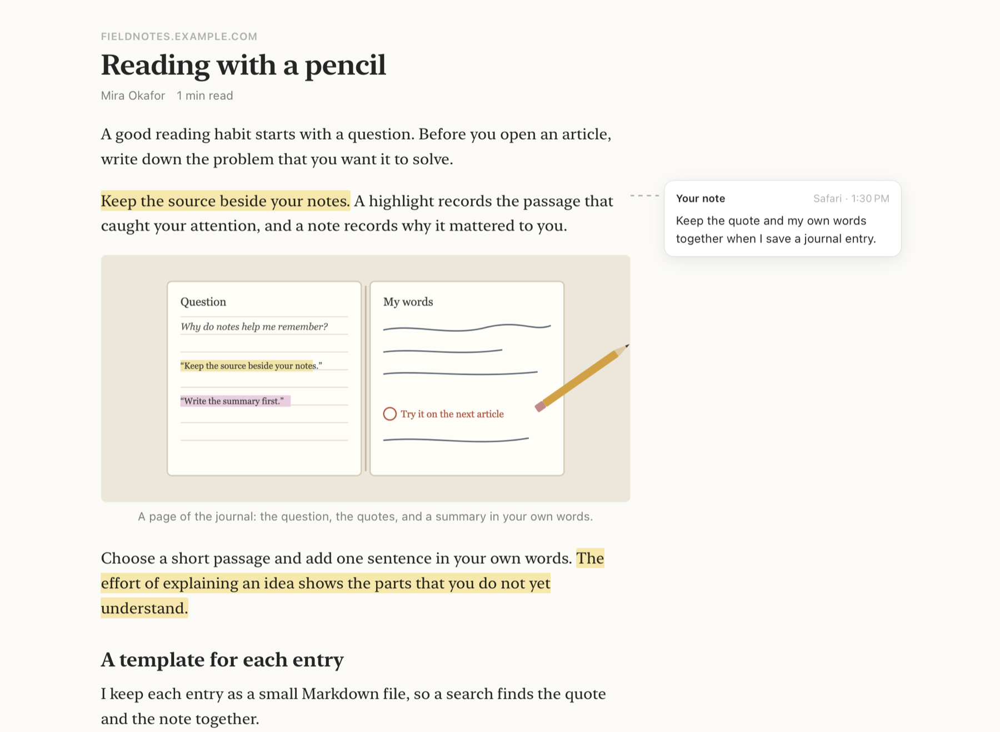
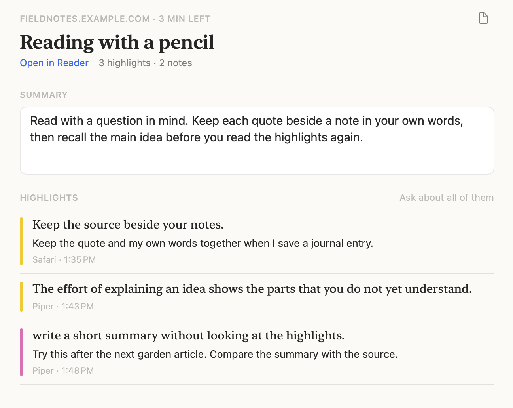

# Browse And Edit Files

The main window keeps one or more folders in the sidebar. The selected folder is the active vault. Any folder works: Piper needs no index, no frontmatter, and no folder names. See [Wiki files](../concepts/files.md) for the scan rules.

Open the window with Command-2.

## Add A Folder

The default folder is `~/Desktop/Wiki`.

1. Open the main window with Command-2.
2. Select Add Folder in the + menu of the toolbar, above the sidebar.
3. Select one or more folders.
4. Select Add.

Add Folder is also in the sidebar context menu and in Settings > General. When the pointer is on the sidebar, a + button also shows beside the Folders heading.

Piper keeps the added folders across restarts. Select a folder in the sidebar to show its folder tree.

To take a folder out of the sidebar, Control-click it and select Remove Folder. You can also select it in Settings > General and select the minus button. The folder on disk does not change. The last folder cannot be removed.

[Go to File](#go-to-a-file) searches the selected folder. Before Piper changes the folder, it saves the open file. If the open file has a conflict, Piper stays in the current folder.

## Find Your Way Around

The window has a sidebar and a detail pane. The sidebar has these groups:

| Group | Rows |
| --- | --- |
| Library | Inbox with a row for each other section, Clipboard, and Done |
| Claude | Each folder with agent sessions, and its sessions. See [Find a session](claude.md#find-a-session). |
| Folders | Every folder, and the tree of the active folder with its files |

The sidebar selection decides what the detail pane shows:

| Selection | Detail pane |
| --- | --- |
| Inbox, a section, or Done | The capture that you select in the list of captures. The list shows between the sidebar and the detail pane. |
| Clipboard | The clipboard history |
| A file | The file |
| A folder | The last file that you opened |
| A folder in the Claude group | A new session in the folder |
| A session | The session |

The window title names the open file. The subtitle shows the folders of the file, for example "Notes › Reading". For other selections, the title names the selection and the subtitle shows a count.

The toolbar has these controls:

| Control | Action |
| --- | --- |
| Toggle Sidebar | Hides or shows the sidebar |
| + | New Section and Add Folder |
| New Capture | Moves the focus to the note composer in the main window |
| Back and Forward | Moves through the files you opened |
| Mark as Done | Marks the selected capture as done, or opens it again |
| More | Reveal in Finder, Refresh, and Settings |

Tabs float over the bottom of the detail pane. A Markdown or HTML file has Preview and Source. A capture with a link has Reader, Web, and Notes.

The folder tree shows every folder and every file, as in an editor. Folders come first, then files. Each file and folder shows its full name, with the extension. Every folder starts closed. Each top-level folder shows a colored tile with the first letter of its name. The arrows that open and close folders show only when the pointer is on the sidebar. The arrow keys open and close folders at all times.

- Select a file to open it.
- Click a folder to open or close it. The detail pane keeps the last file.

When a link opens another file, the tree selects that file and opens the folders above it.

The window restores its frame, the pane widths, the selection, the open folders, and the last file.

## Search Captures And The Clipboard

The search field sits at the top of the list of captures and at the top of the clipboard history. In Inbox, search filters the notes of every section. In Clipboard, search filters the clipboard history.

To find a file, use [Go to File](#go-to-a-file).

## Read A File

Select a file in the sidebar tree.

A Markdown file opens in the editor, in a centered column. The page uses the paper, the type, and the colors of the Reader tab. A byline over the text shows the modification date and the reading time. After a save, the byline also shows "Saved". The byline scrolls with the text. If the file has no heading, its title shows under the byline.

An image line, such as ``, shows the image. The path starts at the folder of the file, or at the vault root when it starts with `/`. An image with an HTTP or HTTPS address loads from the web.

Wiki links use `[[Note]]`, `[[folder/Note|Label]]`, and `[[Note#Heading]]`. Relative Markdown links open from the current file. HTTP, HTTPS, and `mailto` links open in your default app. To follow a link while you edit, Command-click it.

To ask an agent about the open file, press Option-Command-C. See [Talk to an agent in a session](claude.md#talk-to-an-agent-in-a-session).

Use Command-[ and Command-] to go back and forward. To scan the folder again, press Command-R, or select Refresh in the More menu.

## Change Reading Preferences

Open Settings with Command-comma, then select Reading. The preferences change how Piper shows a Markdown file. They do not change the file.

| Preference | Values | Default |
| --- | --- | --- |
| Font | Mono, Serif, Sans | Serif |
| Size | 13 to 24 points | 18 points |
| Paper | Paper, Sepia, Slate | Paper |
| Appearance | System, Light, Dark | System |

Serif is New York, the serif of macOS. Mono is IBM Plex Mono. Paper is the background color of the Reader tab. Reset to Defaults restores the defaults.

## Preview Other Files

Piper opens every file in the vault, not only Markdown.

- HTML, RTF, images, PDFs, and other rich files use the macOS Quick Look preview.
- JSON, plain text, source code, and other text files show as read-only monospaced text.
- Open in Default App opens the file in another app. The folder button reveals the file in Finder.

A file larger than 4 MiB, or a file that is not UTF-8 text, uses the Quick Look preview. Piper cannot edit it, even if it is Markdown.

## View The Source

For a Markdown or HTML file, select Source in the tabs at the bottom of the pane. The choice stays for the next file. Select Preview to go back to the formatted page.

For Markdown, Source is an editor for the raw text of the file, including the frontmatter. Piper saves an edit in Source the same way as an edit in Preview. For HTML, Preview shows the page and Source shows its markup as read-only text. The control is off for a file that has no source text.

## Edit A Markdown File

1. Select a Markdown file.
2. Type in the page.

Piper saves the file 120 ms after you stop typing. The file needs no Save command. Command-S saves at once.

The editor is the editor of [Hubble.md](https://github.com/bholmesdev/hubble.md). Formatting shows as you type:

- Markdown shortcuts work, for example `# ` for a heading, `- ` for a list, and `**` for bold.
- A `/` at the start of a line opens a list of blocks: headings, lists, a to-do list, a quote, a divider, and a table.
- Command-K makes a link from the selected text. Type `[[` to link to another file.
- Command-Z reverses an edit.
- A footnote shows as a small number in the text. Its note shows at the place of `[^label]: text` in the file. To add a footnote, type `[^1]` after a word. Then type `[^1]: ` and the note at the start of a line.

A file with frontmatter shows its keys as properties over the text. You can change a value, change the type of a key, or select Add Property. If the YAML is not valid, the properties show as read-only text.

A save writes the text of the editor. The editor changes some Markdown to one form. For example, `*` bullets become `-`, and `__bold__` becomes `**bold**`. The text, the links, and the frontmatter do not change.

### Highlight And Ask In A File

Select text in a file to show the selection bar. It is the bar of the Reader tab, with Bold, Italic, and Link at the end. See [Highlight and ask in the Reader tab](#highlight-and-ask-in-the-reader-tab).

- A highlight color writes the highlight into the file. Yellow is `==text==`. Green and pink are `<mark class="green">text</mark>` and `<mark class="pink">text</mark>`. To remove a highlight, select the text and the same color again.
- Note writes a yellow highlight into the file, and keeps your note in Piper. The note shows as a card in the margin.
- Ask, Explain, and Define send the selection to the margin agent. The answer shows as a card in the margin, and Piper keeps it. The file does not change. A dashed line marks the text of each question.
- Capture saves the selection as a new capture in Inbox.

Piper keeps the notes and the answers of a file under one capture in Inbox, with the address `piper-file://` and the path of the file. If you rename or move the file, its cards do not follow it.

If the pane is too narrow for the margin, the cards show under the text. In a read-only Preview, the bar has no colors, no Note highlight, and no formatting.

### When Preview Is Read-Only

Some Markdown has no place in the editor, for example link titles and table alignment. A save from Preview would remove it. For such a file, Preview is read-only, and a bar over the page names the syntax. To edit the file, select Edit in Source.

### When The File Changes On Disk

An agent or another app can write a file while it is open in Piper.

- If you have no edits that are not saved, the page shows the new text.
- If you have such edits, Piper stops saving the file, and a bar shows over the page. If a Claude session of Piper wrote the file, the bar says so.

In the bar, select one of these:

- Reload shows the text on disk and removes your edits.
- Keep Mine writes your text over the change on disk.

Piper does not change the folder or quit while a file has this bar. It shows the file, so you can choose.

## Find Text In A File

1. Press Command-F.
2. Type the text.
3. Press Return for the next match.

The find bar also replaces text. Press Escape to close it.

## Go To A File

1. Press Command-K, or select Go > Go to File.
2. Type a part of the file name or the title.
3. Use Up and Down to select a row, then press Return.

With an empty field, the palette lists the files that you opened last. With 3 characters or more, it also lists lines in files that hold the text. Type `/` to list commands, such as Find in File and Refresh. The commands that you ran last show first. Press Escape to close the palette.

## Add An Image Or An HTML File

To add an image, paste it or drag it into the page. Piper saves the image in a folder next to the note, `<note name>.assets`, and adds a link to it.

To show an HTML file of the folder in a note, add a line like this:

```html
<iframe src="./chart.html"></iframe>
```

The page shows the HTML file in a frame. Piper reloads the frame when the file changes. The frame cannot read or change other files, and its links do not open.

## Read Captures In Inbox

Select Inbox in the sidebar to see the notes and links of every section in one list. Inbox also becomes the section for new notes. Select a section under Inbox to show only its captures and make it the section for new notes. Select Clipboard to see the clipboard history. See [Capture notes](capture.md) for the actions on a capture.

The field to add a note is at the top of the list. The list shows the newest capture first, in day groups: Today, Yesterday, This Week, and Earlier. A note shows only its text. To see its time or its source app, move the pointer over the row. A link shows its site, and its number of highlights or its reading time. A capture from a section other than Inbox shows the dot and the name of its section. The chips over the list choose what the list shows:

| Chip | Captures |
| --- | --- |
| All | Every capture. Continue Reading over the day groups shows up to three articles that you started. See All selects Reading. |
| Notes | The captures that are not links |
| Reading | The links, in Continue, Up Next, and Finished This Week. See [Keep a reading list](#keep-a-reading-list). |

Piper keeps the chip of each section until you quit.

The captures that you mark as done today show under "done today" at the end of All and Notes. Select the line to show or hide them.

A note has a circle. Select the circle to mark the note as done. A link has a ring that fills as you read. Select the ring to mark the article as read, or to read it again. A completed note and a read article show a gray check, and their titles are gray.

A link shows the first line of its title, and its site under the title. A started article also shows the minutes left. If a capture has highlights, notes, or questions, their number shows on the second line. Select the number to open the list of them. Select it again to close the list.

Select one capture to show it in the detail pane. The date shows at the top. Type in the text to change the note. Piper saves the change shortly after you stop typing. If the note looks like source code, the text uses a monospaced font. The editor does not change quotes or dashes while you type. The source app shows under the text.

A capture that holds only a web link opens in the Web tab. A click on one of its highlights or questions opens the Reader tab at that text. Its agent session, if it has one, shows in the session card. A note that holds a link and more text opens in the editor. To read its link, Control-click the note and select Add Link to Reading.

The tabs at the bottom of the pane show Reader, Web, and Notes for a capture with a link. The Reader tab shows the article as clean text, with the site, the title, and the reading time. In a narrow pane, notes appear below the article. In a wide pane, they appear in the margin. The Web tab shows the original page. The Notes tab shows the notes of the article. If Piper cannot find the article text, select Show Web Page.

While the article loads, the Reader tab shows the site, the title when Piper knows it, and gray lines in the place of the text. If the page takes more than five seconds, a line says that the page is slow. When the text arrives, it moves into place. If Reduce Motion is on in the Accessibility settings of macOS, nothing moves.

The bar over the article shows the minutes left, and a line under it shows the progress. Piper saves your place when you stop scrolling. The next time, the article opens at that place, and a line over the article says so. To go to the title, select Start from the top. An article that you highlighted in a browser, and did not open in Piper, opens at your newest highlight.

### Highlight And Ask In The Reader Tab



Select text in the article to show the selection bar. The bar has Ask, Explain, Define, three highlight colors, and Capture.

- To mark the text, select a color.
- To get an explanation, select Explain.
- To get the meaning of a word or a phrase, select Define.
- To ask your own question, select Ask or press Command-K. Type the question, then press Return.
- To write your own note, select Note or press N. Type the note, then press Return. Piper saves a yellow highlight with the note.
- To save the selection as a new capture in Inbox, select Capture.

Ask, Explain, and Define send the selection to the margin agent. By default, the margin agent is Claude Code with Haiku. To change the agent or the model, open Settings > AI > Defaults.

The first question about a capture also sends the article text. One hidden session answers every question about one capture. The sidebar does not show this session.

The margin agent works in the folder of the Send buttons. It can read the files of that folder and search the web. It cannot change a file or run a command, so it never asks for your approval. Claude Code gets only the Read, Grep, Glob, WebSearch, and WebFetch tools, and no MCP server. For an ACP agent, Piper uses the read-only mode of the agent, such as Plan. Piper also allows each request that only reads, and denies each other request. An ACP agent without a read-only mode cannot answer in the margin. See [Choose the agent, the model, and the mode](claude.md#choose-the-agent-the-model-and-the-mode).

Your notes show as plain cards in the margin, with the app and the time. To move to the next or the previous mark, press Option-Down Arrow or Option-Up Arrow.

The answer shows as a card in the margin, next to the underlined text. The card names the model and the agent. If the answer used tools, a line under the answer names them, for example "Used 2 reads, 1 search". To ask a follow-up question, type in the card and press Return. To hide a card, select its close button. To show the card again, select the underlined text.

To continue with an agent that can change files, select Continue in Session on the card. Piper opens a draft session with the question thread and the address of the page. The agent starts only after you send the draft.

Each highlight and each question is a note under the link capture. In the list, these notes show under the capture with their tags: highlight and a color, or question. Select a note in the list to scroll the Reader tab to its text. To add a tag, Control-click the note and choose Add Tag. When you delete the capture, Piper also deletes its notes.

Each note keeps the quoted text and its place in the article. If the article text changes, Piper looks for the quote in the same paragraph first, then in the whole article. If the quote is gone, the note stays in the list and the article shows no mark.

### Use The Web Tab

The reader bar has these controls: Note, Back, Forward, the address with Reload, Capture, and Open in Browser. If a page fails to load, select Try Again.

To save part of a page as a new capture:

1. Select text on the page.
2. Select Capture in the reader bar.

If no text is selected, Capture saves the whole page text. The new capture goes to Inbox with the page title and URL. The original capture does not change.

Piper loads HTTP and HTTPS pages only. A page needs a network connection.

## Keep A Reading List

Select the Reading chip over the Inbox list. Reading shows each capture that holds only a web link, and each page that you saved from a browser.

| Group | Articles |
| --- | --- |
| Continue | The articles that you opened or highlighted. The newest activity is first. |
| Up Next | The articles that you did not open |
| Finished This Week | The articles that you read to the end in the last seven days |

The count on the Reading chip includes all three groups. When you scroll to the end of an article, or select its ring, Piper moves it to Finished This Week. Seven days later, Piper marks it as done, and it moves to Done. Piper makes this check at launch and each time the main window becomes active.

### Use The Notes Tab



Select Notes in the tabs at the bottom of the pane. The Notes tab shows one page for the article:

- The summary. Type it in the box. Piper saves it as a note under the article, with the tag `summary`.
- Each highlight with your note, the app where you made it, and the time. Select a highlight to open the Reader tab at its text.
- Each question to the margin agent, with the last answer.

Ask about all of them sends each highlight and note to the margin agent of the article. The answer shows under Questions.

### Save The Notes As A File

1. In the Notes tab, select the file button, Save as File.
2. Choose a folder.
3. Choose the parts: the highlights and your notes, the summary, and the agent answers.
4. Select Save.

Piper writes one Markdown file in the folder. The front matter holds the `source` URL, the `title`, and the `read` date. If a file with the same name exists, the new file gets a number.

After the save, the button shows the number of highlights that are new or changed. To add them to the end of the file, select Update File. Piper writes them under a heading with the date. Piper does not change the file until you select Update File.

For all shortcuts, see [Keyboard shortcuts](shortcuts.md).
