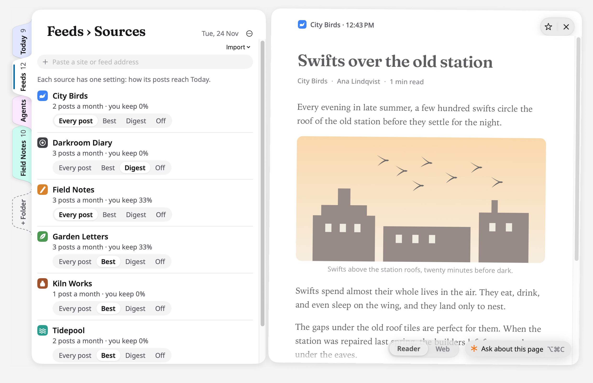

# Read Feeds

Piper reads RSS, Atom, RSS-in-JSON, and JSON Feed. The new articles of your feeds show in Today, with your notes and links. See [Capture notes](capture.md#today). Sources is the only place where you add, set, and remove feeds.

## Browse Your Feeds

The Feeds tab comes after Today on the feed paper. Its index shows Sources first, then each feed with its site icon, its title, and its number of unread articles. The count on the tab is the number of unread articles of all feeds.

To show the Feeds index, click the Feeds tab. Select a feed to show its articles, or select Sources to add and manage feeds.

When the Feeds tab shows a list, the title of the paper is "Feeds › Sources" or "Feeds › " with the title of the feed. To show the index again, press Left Arrow or click the Feeds tab.

## Open Sources

Do one of these steps:

- On the Feeds index, select Sources.
- On the feed paper, press Command-2.
- Choose Window > Feeds, or choose Feeds in the command palette.
- In the More menu of the feed paper, choose Add Feed. Sources opens with the cursor in its address field.
- Press Shift-Command-N, or choose File > Add Feed. Sources opens with the cursor in its address field.
- In the command palette, choose Add Feed.
- Paste the address of a site or a feed in the capture field of Today, then press Return. Sources opens and looks for the feeds at that address.

Sources lists each feed with these items:

| Item | Content |
| --- | --- |
| Icon | The icon of the site, or the first letter of the title until Piper finds an icon |
| Rate | The posts in a week, or in a month for a quiet feed, from the last 4 weeks |
| Keep rate | The part of the posts that you kept as link captures |
| Mode | How the posts of the feed reach Today |

Select the title of a feed to show all of its articles. Right-click a feed for Show Posts, Open Site in Browser, Copy Feed Address, and Remove Source. Remove Source removes the feed and its articles.

## Choose How A Feed Reaches Today

Each feed has one mode. Piper saves the mode with the feed.

| Mode | Today shows |
| --- | --- |
| Every post | One row for each new article |
| Best | One row for each article on a quiet day. On a busy day, the 2 best articles get rows, and the others go into a digest row. |
| Digest | One digest row for each day with new articles |
| Off | No rows. The articles stay on Sources. |

A day with more than 3 new articles from one feed is a busy day. A digest row shows the feed title, the count of new articles, and the first titles, for example "Fieldstone Weekly · 9 new".

To change the mode, select it on Sources. You can also right-click an article or a digest row in Today, and choose Show Posts.

### How Piper Finds The Best Articles

Piper gives each article a score from 0 to 1. The score uses only data on your Mac. Piper sends no request and uses no AI for it. The score has these parts:

- The keep rate of the feed.
- The visits to the site of the article in your recent browser history.
- The words of the title that are also in the names of the files in your active folder.

An article with a score of 0.25 or more is a best article. Its row says "matches your reading".

## Add A Feed

1. Open Sources.
2. Paste or type the address of a site or of a feed in the add field.
3. Press Return, or select Find Feeds.
4. Select Add on the feed that you want.

## Import Subscriptions

1. Open Sources.
2. Open the Import menu.
3. To import the subscriptions of NetNewsWire, choose Import from NetNewsWire.
4. To import another OPML file, choose Import OPML File, and select the file.

Piper reads the On My Mac account of NetNewsWire. The import adds each feed one time and skips the feeds that Piper has. The import does not copy articles, read marks, or stars. Piper does not read NetNewsWire after the import.

If Piper cannot read the NetNewsWire file, give Piper Full Disk Access. You can also export the subscriptions from NetNewsWire as an OPML file, and import that file.

## Read Articles

Select an article row in Today to read it on a reader paper. Select a digest row, then press Return, to show the articles of that feed. The reader paper is the same reader as a link capture. The Reader tab shows the article as clean text, and the Web tab shows the original page.

When you open an article on a paper or in the browser, Piper marks it as read. You cannot undo this mark. An article stays in Today for 7 days. Piper removes a read article 30 days after it arrives, unless you kept it.

The list of one feed has these keys:

| Key | Action |
| --- | --- |
| Return | Open the selected article on a paper |
| Space | Open the next unread article on a paper |
| K | Keep the article |
| B | Open the article in the browser |
| Shift-Command-K | Mark all articles in the list as read. File > Mark All as Read does the same. |

K and B also act on an article paper with the focus. The toolbar of an article paper has Keep. Right-click an article in the list for Mark as Read, Keep, Open in Browser, and Copy Link. Copy Link shows "Copied" in the toast.

Mark as Read, Mark as Unread, the dot of a row, and Mark All as Read add an undo step. To undo the mark, press Command-Z or choose Edit > Undo.

## Keep An Article

Keep saves the article as a kept link capture. The source of the capture is the title of the feed. To keep an article, use one of these:

- Press K on the article row in Today, or on its paper.
- Select the star button on the row.
- Select Keep in the More menu or the context menu of the row.

A kept article shows in the Kept lens and the Reading lens. Today shows one row for the article and its capture. A highlight or a note on a feed article also keeps the article, because a note needs a capture.

## Refresh

Piper refreshes each feed every 30 minutes, while Piper is open. Piper refreshes up to 4 feeds at the same time. To refresh all feeds now, show the list of a feed, then select the refresh button (a circular arrow) at the top right.

If a feed fails, its list shows a warning icon. Move the pointer over the icon to read the error. Piper tries again after 30 minutes, and again after 30 more minutes. Then the waits are 2 hours, 8 hours, and 24 hours.

## Sites You Read Often

Sites You Read Often is at the end of Sources. It shows the sites of your browser history that have a feed and no subscription. It uses no AI.

1. Piper reads the last 14 days of browser history on this Mac.
2. Piper ranks the sites by visits. A recent visit counts more than an old visit.
3. Piper loads the home page of each site and looks for a feed.

Each site shows Add and Ignore. Ignore hides the site from later scans.

Piper scans when you open Sources and the last scan is older than one day. To scan now, select Scan Again.

The history does not leave your Mac. The scan sends one request to the home page of each site, and more requests to the feeds that the page names.

## Choose The History Sources

Open Settings > Feeds.

- To stop Piper from reading a browser, turn off its switch.
- If a source shows Open Privacy Settings, Piper needs Full Disk Access to read it. Safari needs this access.
- To block a site, add its host to Blocked Sites. Type one host on each line. A block also covers each subdomain.

Piper always blocks private addresses.
