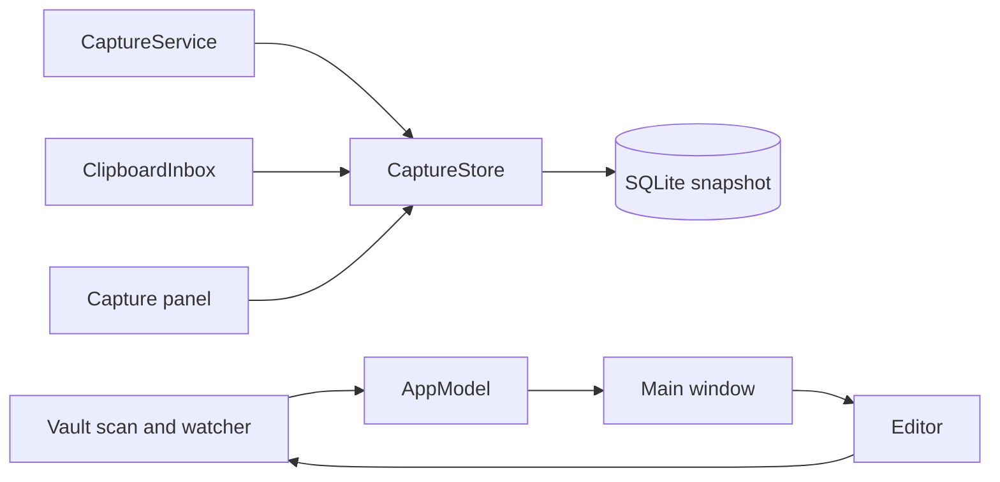

# Architecture

Piper is a Swift package. Model code lives in modules under `Sources/Modules`. The `Piper` application target sits above them and holds the windows and views. AppKit owns the windows and the panes. SwiftUI draws most pane content. The rules for new code are in [Coding guidelines](coding-guidelines.md).



## Modules

| Module | Responsibility | Depends on |
| --- | --- | --- |
| `CSQLite` | System SQLite, through `pkg-config` | nothing |
| `PiperCore` | `PiperError` and the frontmatter parser | Yams |
| `PiperTree` | `Node`, `TreeController`, and `PathTreeBuilder` | nothing |
| `CapturesDatabase` | One versioned blob in SQLite, with compare-and-swap | `CSQLite` |
| `Captures` | `Note`, `CaptureStore`, `ClipboardInbox`, `CaptureLinks`, and edit sessions | `PiperCore`, `CapturesDatabase` |
| `Vault` | One folder: scan, read, write, and watch | `PiperCore`, Yams |
| `Agents` | `SessionRunner`, `AgentSession`, `AgentConnection` with `ClaudeCodeConnection` and `StdioAgentConnection`, the `ACP` types, `AgentProbe`, `SessionEvent`, `FolderSkill`, `SlashCommand`, and `PermissionRule` | `PiperCore`, `CapturesDatabase` |
| `Piper` | Windows, panes, views, and app state | All modules, Yams, and `MarkdownEngine` |

`PiperCore`, `PiperTree`, and `CapturesDatabase` have no dependency on another Piper module. `PiperCore` holds the frontmatter parser and Home search models.

Each module has a test target with the same name and a `Tests` suffix. `PiperTests` tests the application target.

## Windows

`AppDelegate` in `PiperApp.swift` creates each window when it first shows. It owns these windows:

| Window | Owner |
| --- | --- |
| Capture panel | `CapturePanelController` |
| Main window | `MainWindowController` |
| Settings | `SettingsWindowController` |
| Note editor windows | `AppDelegate`, one for each note |
| Capture toast | `AppDelegate` |
| Reading toast | `ReadingToast`, which `AppDelegate` owns |

The capture panel and the main window are exclusive. `showPanel()` hides the main window, and `showLibrary()` hides the panel. Neither closes, so drafts and edit sessions stay. Closing every window leaves the app running in the menu bar.

The panel is a non-activating `NSPanel` on every Space. Its initial size is 600 by 960 points with 22-point corners. It scales down on a small screen.

### Main Window

`MainWindowController` owns the toolbar and an `NSSplitViewController` with four split items:

| Pane | Controller | Content |
| --- | --- | --- |
| Sidebar | `SidebarViewController` | `SidebarOutline`, an `NSOutlineView` |
| List | `FileListViewController` | `FileListView`, `CaptureView`, or `SessionListView` |
| Detail | `DetailViewController` | `HomeView`, `WikiEditor`, `FilePreview`, `NoteDetail`, or a session |
| Session card | `DetailViewController` | `SessionOverlay`, in a hosting view over the bottom right corner of the detail pane |

Each controller subclasses `HostingPaneViewController`, which wraps an `NSHostingView`. A pane reports upward through a delegate protocol, and `MainWindowController` decides what the other panes show. `WikiEditor` is an exception. It calls `AppModel.openDocument` directly, so a link does not move the sidebar or the file list.

`SidebarSelection` decides the layout. Home collapses the file list because the search field needs the width. A Sessions folder hides the session card, because the list and the detail pane show the same sessions. `MainWindowState` saves the selection, the open file, the open folders, and the pane widths. `AppModel.selectedSession` holds the session that the session card and the Sessions list show.

`AppModel.sessionPresentation` is the pill, the card, or the detached panel, and preferences keep it. `DetailViewController` holds two hosting views: the content, and an overlay pinned to the bottom right corner. The overlay takes the intrinsic size of `SessionPill` or `SessionCard`, so a click outside it reaches the content. A constraint keeps the overlay at most 85% of the pane height. `DetailPaneLayout` shares the pane width between the card and the tabs. In a narrow pane, the card fits the width and sits above the tabs. `SessionCard` hosts `SessionPane`, and `SessionTarget` picks its folder, its session, and its context page. `SessionPanelController` shows the same card in a non-activating `NSPanel` on every Space. Its close button returns the presentation to the pill.

The window title names the sidebar selection, as in Mail. The subtitle shows a count, and it updates through `withObservationTracking`. The toolbar has tracking separators that align with the split view dividers. Toggle Sidebar sits over the sidebar. New Capture sits over the list. Back and Forward, Mark as Done, and the More menu sit over the detail pane. `TabIsland` floats over the bottom of the detail pane, with Preview and Source for a file. The Session Card button at the end opens and collapses the session card, as does Option-Command-C. Each list has its own search field.

The sidebar has up to three groups. Library holds Home, Inbox with one child for each capture section other than Inbox, Clipboard, and Archived. Claude holds one `SidebarSelection.sessions` row for each folder with sessions, and it shows only when a session exists. Folders holds every root and the tree of the active root. `SidebarSelection.section` shows the captures of one section, and `SidebarSelection.clipboard` shows the clipboard history.

Sidebar fonts and icons follow the macOS sidebar size preference: 11 and 16 points, 13 and 19 points, or 15 and 22 points. `TimelineCell` draws every file row through `TimelineRow`.

## Capture

`CaptureService` detects double Shift with `NSEvent` monitors. Control-Option-Space is a registered system hotkey, so the source app does not receive the keystroke.

The service records the source app and the active section before it reads Accessibility text. A serial queue reads the focused element with a 0.4-second timeout. If the selected text attribute is empty, the service uses the selected range. Secure fields produce no note.

The service then looks for a web page. It reads `AXDocument` from the focused element and the window, and `AXURL` from the `AXWebArea`. The web area is the first ancestor of the focused element with that role, or else the first web area in the window. If a web page is in front, the service also reads the window title and the text of the whole web area. The text comes from the `AXTextMarkerRangeForUIElement` and `AXStringForTextMarkerRange` attributes, which WebKit and Chromium both have, with a 1.5-second timeout.

`CaptureService.save` turns the result into a `CaptureOutcome`:

| Selection | Web page | Outcome |
| --- | --- | --- |
| The text of the highlight on the toast, or none, while the toast shows | Any | `comment`: the toast opens the note field |
| Text | Yes | `highlight`: `CaptureStore.saveHighlight` |
| None | Yes | `article`: `CaptureStore.saveArticle` |
| Text | No | `note`: `CaptureStore.add` |
| None | No | `note` with an error message and no id |

`CaptureStore.article(for:)` finds a link capture by the link that `CaptureLinks.canonical` returns, so two links to one page share one capture. `NoteAnchor.normalized` collapses the white space of a browser selection, as the Reader tab does. The anchor of a browser highlight has block -1. `NoteAnchor.locate` finds the quote when the Reader tab opens. A quote can run over more than one block. In that case, `locate` searches the blocks joined with spaces. The mark stops at the end of the first block. If the article holds only a part of the quote, it tries shorter starts of the quote, down to four words.

`ReadingToast` is a borderless, non-activating `NSPanel`. It shows a new highlight, a saved page, or the note field. Only the note field makes the panel the key window. Piper never becomes the active application, so the browser gets the keyboard back when the panel closes. `CaptureService.shownHighlight` reads the highlight on the toast, so a second capture of it asks for a note.

`CaptureStore` builds a candidate state and saves it before it replaces the current state. `Database` compares the stored blob with the last loaded blob on every save. A database error or a stale snapshot leaves the current notes as they are. See [Local storage](../concepts/storage.md).

`ClipboardInbox` polls the pasteboard and keeps the 50 latest texts from the last 7 days, with the copy time and the app in front. It stores them in the `clipboard` table through the `Database` of `CaptureStore`. `ClipboardRow` in `CaptureRows.swift` saves to Inbox with Keep, and pastes through `ClipboardPaster` on a double-click.

`CaptureView` draws the capture list for both windows. In the panel, the list holds every section under a header, and a `SectionScroll` request scrolls it to one header. In the main window, `CaptureListContent.stream` shows the `InboxStream` of the sidebar selection: every section for Inbox, or one section. `InboxStream` filters the captures by section, chip, and search, and groups them as Continue Reading and days, or as Continue, Up Next, and Finished This Week. `AppModel.inboxFilters` keeps the chip of each section. `InboxRow` draws each capture of the stream, and `NoteContextMenu` gives the panel rows and the stream rows the same menu. In the main window, a click on a row sets the selection to that capture, which opens it. Command-click and Shift-click set `checking` and select several captures. The selection bar shows while `checking` is true. The circle completes a note, and the ring marks an article as read. `NoteDetail` shows a link capture in its tabs and any other note in an editor. `SessionTarget` reads the open note from `AppModel.actionTarget`. For a note, the card shows the selected session when it belongs to the note, or else the newest session of the note, and it leaves out the margin sessions. A message from the card starts a session with the `noteID` of the note. `AppModel.newSessionNote` keeps the card empty after New Session. The child notes of an article stay hidden until the reader opens them. Archived shows `InboxStream.archive`, which groups the done captures by the month of `modifiedAt`, because marking a capture as done sets that time. The main-window controller routes note selection to the detail pane and limits shortcuts to the Inbox pane.

## Agent Sessions

`FolderAgents` in the application target holds the agents, the defaults of a new session and of a margin answer, the sidebar folders that have skills, the default folder, and the default skill for links and for text. `AppModel` refreshes the folders when the folder list changes, on each scan, and when the capture panel becomes key.

`SessionRunner` in the `Agents` module owns every `AgentSession`. Each session is an `@Observable` object, so a view of one session redraws only when that session changes. A session records its agent, its purpose, its model, its mode, and the ACP session id in `resumeToken`.

The runner reads only Agent Client Protocol (ACP) v1 terms. Each session has one `AgentConnection`, and the connection sends `AgentEvent` values to the runner:

| Event | Effect |
| --- | --- |
| `ready` | Stores the session id, the modes, and the config options of the agent |
| `update` | Applies one `session/update`: a part of a message, a tool call, a change to a tool call, the commands, the mode, the options, or the usage |
| `permission` | Adds a request. The session changes to `needsYou`, and the approval drawer shows the options of the agent. |
| `turnEnded` | Adds a result block with the time, the cost, and the failure, and ends the turn |

Parts of a message in a row join into one text block. A tool call keeps its ACP kind, and the transcript folds the calls of a finished turn by kind. A path stays only for a call that writes a file inside the folder.

### Connections

`ClaudeCodeConnection` runs Claude Code with no adapter. It starts one `AgentProcess` with this command in the folder:

```
claude -p --input-format stream-json --output-format stream-json --verbose \
  --permission-prompt-tool stdio --permission-mode <mode> [--model <model>] \
  [--tools <tools> --allowedTools <tools>] [--resume <id>]
```

The mode is `auto` and the model is `sonnet` by default. An empty model omits `--model`. A margin session adds `--tools` and `--allowedTools` with `Read,Grep,Glob,WebSearch,WebFetch`, and `--strict-mcp-config`. `--tools` limits only the built-in tools, so `--strict-mcp-config` removes the MCP servers of the user settings. The process then has no other tool. Claude Code takes a new model or mode only at start, so the runner closes an idle process after a change.

Each message is one JSON line on standard input: `{"type":"user","message":{"role":"user","content":[{"type":"text","text":...}]}}`. A context file goes after the text as a `Context file: <path>` line. A slash command takes the path as its argument.

`SessionEvent.parse` reads each line of standard output, and the connection turns it into ACP:

| Line | Event |
| --- | --- |
| `system` with subtype `init` | `ready` with `session_id`. The slash commands become a commands update. |
| `assistant` text | An agent message. A second text in one turn starts a new paragraph. |
| `assistant` tool use | A tool call with the kind of the tool. `Write`, `Edit`, `MultiEdit`, and `NotebookEdit` record the file. |
| `user` with a `tool_result` | A change of the tool call to completed or failed |
| `control_request` with subtype `can_use_tool` | A permission request with Allow Once, Always in the folder, and Deny |
| `result` | `turnEnded` with the time, the cost, and the failure |

A message from a subagent carries a `parent_tool_use_id`, and the parser skips it. A request sends one `control_response` line with the `request_id`. Allow sends `{"behavior":"allow","updatedInput":<input>}`. Deny sends `{"behavior":"deny","message":...}`, and Claude Code reads the message as the tool result. An answer to `AskUserQuestion` adds `answers`, a map from each question to the chosen labels, to `updatedInput`. A message that the reader sends while a request waits becomes the deny message of each waiting request, so Claude Code reads it in the same turn. Always also writes the rule from `PermissionRule` into `.claude/settings.local.json`. The connection then allows later calls with that rule in the folder for the rest of the launch.

A turn fails when `is_error` is true, when the subtype is not `success`, or when `permission_denials` names a call that the reader did not deny.

`StdioAgentConnection` runs a command that speaks ACP, as JSON-RPC 2.0 with one message on each line. It sends `initialize` with no file system and no terminal capability, so the agent uses its own tools. Then it opens the session:

- `session/load`, for a known session id when the agent offers `loadSession`. The connection skips the history that the agent replays.
- `session/resume`, for a known session id when the agent offers only `resume`.
- `session/new` in all other cases, or when a load fails.

A prompt waits until the session opens, and goes out as `session/prompt`. The `stopReason` of the response ends the turn. Stop sends `session/cancel`, and each request that waits gets the outcome `cancelled`. A request for a method that Piper does not offer gets the error `-32601`.

The connection changes the mode with `session/set_mode`, and the model with `session/set_config_option`. An agent that sends the older `models` list in place of a model option gets `session/set_model`. OpenCode 1.2 does this.

A margin session of an ACP agent shows no request. The runner allows a call of the kind `read`, `search`, `fetch`, or `think`, and denies every other call.

`AgentProcess` reads both pipes with a `readabilityHandler`. A blocking read holds a thread for each idle process, and a few idle sessions then hold every thread of the pool. Piper ignores SIGPIPE, so a write to a process that exited fails without a crash. The process starts through `zsh -l`, so it gets the PATH of the login shell, and a command can be a name on that PATH.

`AgentProbe` checks the health of each agent for Settings. For Claude Code, it runs `claude --version` and `claude auth status`. For an ACP agent, it sends `initialize` and reads the answer. Each check stops after 10 seconds.

### Turns

At most two sessions are in a turn. Other turns wait. A timer stops a turn after 10 minutes of work. The timer stops while a request waits. After a turn, the process stays open for the next message. It ends on Stop for Claude Code, on a failure, on Delete Session, on a change of the model or the mode of Claude Code, or when Piper quits. Then the next message starts a new process that resumes the session.

The session composer handles Return, Tab, the arrows, and Escape in `textView(_:doCommandBy:)` of `CaptureEditor`. An `NSEvent` monitor kept the view from its first appearance, and Return then sent to an old session.

`SkillTarget` names what the main window shows: `page(path)`, `text(text, noteID)`, or `folder`. `MainWindowController` sets `AppModel.actionTarget` with the selection, and the session card takes a page as context. A Send action opens a session draft with the skill command and note text. The composer sends the edited draft when the reader presses Return.

The `sessions` table stores each session at each change of state. Quit asks before it stops sessions in a turn. `AppDelegate` also stops them on SIGTERM, because a child process keeps running after its parent exits.

## Vault

`Vault` lists every file and folder under the root and applies no rule about structure. `VaultFile` holds the path, size, modification date, text, and parsed frontmatter. `VaultWatcher` wraps `FSEventStream` on a private queue and calls back on the main queue.

`AppModel` stores the folder list and the active root in preferences. `removeWikiFolder` moves the active root to another folder before it removes a root.

`AppModel` starts the watcher with the first scan and replaces it when the active root changes. A scan runs in the background. A change during a scan requests one more scan. A scan keeps unsaved edit sessions and updates clean editors and previews. See [Wiki files](../concepts/files.md).

`FileReadState` stores the last-read modification time of each file. `AppModel` computes unread state and folder counts, including subfolders. The first file selection waits until the detail pane shows before it marks the file read.

## Reading And Editing

`FilePresentation` decides how the detail pane shows a file. Markdown and HTML also have a read-only Source view through `PlainTextPreview`. `AppModel.showsFileSource` holds the choice. Markdown opens in the editor, other text in a read-only text view, and everything else in Quick Look.

`WikiEditor` embeds SwiftMarkdownEngine 0.12.0 through its AppKit bridge. The page is a centered column, at most 640 points wide, with 48-point side margins. `WikiEditor` passes `DetailHeader` to the engine as a header that scrolls with the text. The header shows the date, the reading time, the save state, and a Save button. It also shows the title when the body has no heading. The fonts, the paper, and the selection, code, and highlight colors match `reader.html`. The engine loads a font by its name, so each `WikiReadingFont` must name an installed font.

Only a Markdown text file gets an edit session. `WikiSave.body` writes the original frontmatter bytes and the new body. It refuses to write if the file on disk no longer matches what the editor opened. Navigation, folder changes, window close, and quit resolve an unsaved session through Save, Discard, or Cancel.

`WikiWorkspace` owns the navigation history. `WikiLinks` resolves links and computes backlinks. `WikiMarkdown` parses blocks for the outline, heading anchors, and backlinks.

## Inbox Reader

`NoteDetail` shows a capture. `CaptureLinks` finds HTTP and HTTPS URLs with `NSDataDetector` and keeps the original text. If the capture is only a URL, the reader opens it at once. `AppModel.articleTab` picks the Reader tab, the Web tab, or the Notes tab. `NoteDetail` shows Reader, Web, and Notes in a `TabIsland` at the bottom of the pane.

`NoteWebReader` embeds `WKWebView` through `NSViewRepresentable`, which works on macOS 14. It keeps the requested URL apart from the current URL, so a view update does not restart navigation after a redirect. A new capture selection resets the reader.

`ArticleReader` shows the Reader tab. `ArticleLoader` loads the page in a `WKWebView` outside the window and runs a script in an isolated content world. The script prefers an article container over the main page container. It returns headings, paragraphs, list items, quotes, and code blocks. If it finds no structured blocks, it splits the container text at blank lines. The article stays in memory for the rest of the launch.

`CaptureStore.pageText` returns the page text that a browser capture kept in the `pages` table. `ReaderArticle(url:title:pageText:)` turns each line of 40 characters or more into a paragraph. `ArticleLoader` uses that article when the load fails, or when the kept text has more than 2.5 times the words of the loaded article.

A second `WKWebView` loads `Resources/reader.html`, which allows no network requests. Piper calls `window.piper.render` with the article and `window.piper.setNotes` with the child notes. The page draws the text with `textContent`, so page markup never runs. Each action of the reader comes back through the `piper` message handler. The page draws the article again only when a mark changes, so an answer does not clear a selection.

The page reports the first block on the screen and the progress 250 milliseconds after a scroll stops. `ArticleReader` saves them in `Note.reading` 800 milliseconds later, through `CaptureStore.updateReading`, with no undo step. At a progress of 0.97, it records the finish time. When the article loads, `ArticleReader` records the title, the reading time, and the open time. It then picks the first place: a `ReaderScroll` request for this capture, the saved block, or the newest highlight from another app. A `ReaderScroll` names its capture, so a request for one article does not scroll another.

`ReaderAssistant` in `AppModel` saves highlights and questions as child notes, through `CaptureStore.addChild`. A highlight with a note of the reader is a `note` on the page, which draws it as a plain card. `HighlightText.comment` reads that note from the text after the quote. `NoteAnchor.locate` finds the quote of each note in the current article. One `AgentSession` answers the questions of one capture. Its `noteID` is the first question note. The assistant sends one message at a time and watches the session with `withObservationTracking`. When the turn ends, it appends the result text to the question note. Each answer thus stays after its own message in the transcript.

The Capture button runs JavaScript in an isolated content world. One call returns the selected text or the page text, the title, and the URL. `CaptureStore` saves the result to Inbox.

`ReadingList` in the `Captures` module groups the link captures that are not done into Continue, Up Next, and Finished This Week. `Note.isArticle` is true for a capture without a parent that has a reading state or holds only a link. `InboxStream` and the Continue Reading row of Home read `ReadingList`. At launch, `AppModel` marks as done each article that the reader finished more than seven days before.

`ArticleNotebook` shows the Notes tab. Its summary is a child note with the tag `summary`. `ArticleMarkdown` builds the file of Save as File, and the text that Update File adds. `Vault.write` writes the file, and `Note.reading` records its path and the save time.

`Info.plist` sets `NSAllowsArbitraryLoadsInWebContent`, so WebKit can load HTTP pages. Other network requests keep the default App Transport Security policy.

## Home Search

`HomeSearch` in `PiperCore` ranks `HomeSuggestion` rows. A leading `>` lists local `HomeAction` values. Other text lists file name matches, file text matches, and local actions, in that order.

The file-list search filters the selected folder. Inbox search filters the active capture section and temporary clipboard cards.

Home searches the whole vault. Its Search All Files action opens the `allFiles` sidebar state with a vault-wide list.

## Source Map

| Source | Responsibility |
| --- | --- |
| [PiperApp.swift](../../Sources/Piper/PiperApp.swift) | `AppDelegate`, menus, the menu bar item, editor windows, the toast, and quit |
| [AppModel.swift](../../Sources/Piper/AppModel.swift) | Scans, selection, and edit sessions |
| [AppDefaults.swift](../../Sources/Piper/AppDefaults.swift) | Preference keys, sizes, and metrics |
| [AppNotifications.swift](../../Sources/Piper/AppNotifications.swift) | Notification names |
| [PiperTheme.swift](../../Sources/Piper/PiperTheme.swift) | App colors, shapes, fonts, and shared controls |
| [FileReadState.swift](../../Sources/Piper/FileReadState.swift) | Read timestamps for each file |
| [CaptureService.swift](../../Sources/Piper/CaptureService.swift) | Global shortcuts, Accessibility selection, and web page capture |
| [ReadingToast.swift](../../Sources/Piper/ReadingToast.swift) | The toast of a web page capture and its note field |
| [ReaderAssistant.swift](../../Sources/Piper/ReaderAssistant.swift) | `ReaderArticle`, highlights, notes, and Claude questions of the Reader tab |
| [FolderAgents.swift](../../Sources/Piper/FolderAgents.swift) | Folders with skills, default skills, and every send action |
| [AgentViews.swift](../../Sources/Piper/AgentViews.swift) | The session badge, the Send button, and the skill list |
| [Sessions/](../../Sources/Piper/Sessions) | The session pane, the transcript views, the cards, the message field, the session card, and the detached session panel |
| [SendShortcut.swift](../../Sources/Piper/SendShortcut.swift) | The Control-Option-W hotkey |
| [Modules/Agents/](../../Sources/Modules/Agents) | Skill discovery, command parsing, sessions, the JSON stream, allow rules, and the session runner |
| [CapturePanel/](../../Sources/Piper/CapturePanel) | `CapturePanelController` and `ClipboardPaster` |
| [CaptureView.swift](../../Sources/Piper/CaptureView.swift) | The capture list, tabs, selection bar, and composer |
| [CaptureRows.swift](../../Sources/Piper/CaptureRows.swift) | Capture rows, headers, and the section and note sheets |
| [CaptureEditor.swift](../../Sources/Piper/CaptureEditor.swift) | The composer text view |
| [MainWindow/MainWindowController.swift](../../Sources/Piper/MainWindow/MainWindowController.swift) | Split view, toolbar, and routing between panes |
| [MainWindow/MainWindowState.swift](../../Sources/Piper/MainWindow/MainWindowState.swift) | `SidebarSelection`, restored state, and pane delegate protocols |
| [MainWindow/PaneViewControllers.swift](../../Sources/Piper/MainWindow/PaneViewControllers.swift) | One hosting view controller for each pane |
| [MainWindow/RouteSheets.swift](../../Sources/Piper/MainWindow/RouteSheets.swift) | The error alert |
| [MainWindow/Home/](../../Sources/Piper/MainWindow/Home) | The Home page and its suggestion list |
| [MainWindow/Sidebar/](../../Sources/Piper/MainWindow/Sidebar) | Library rows, the folder tree, unread counts, and file warnings |
| [MainWindow/Browser/](../../Sources/Piper/MainWindow/Browser) | The file list and the session list |
| [InboxRow.swift](../../Sources/Piper/InboxRow.swift) | The rows of the Inbox stream and the progress ring |
| [MainWindow/Detail/](../../Sources/Piper/MainWindow/Detail) | Header, file previews, the Reader tab, and the Notes tab |
| [Modules/Captures/ReadingList.swift](../../Sources/Modules/Captures/ReadingList.swift) | The Reading groups and the Markdown of Save as File |
| [Modules/Captures/InboxStream.swift](../../Sources/Modules/Captures/InboxStream.swift) | The groups and the chip counts of the Inbox stream |
| [MainWindow/TimelineCell.swift](../../Sources/Piper/MainWindow/TimelineCell.swift) | File and capture rows |
| [WikiEditor.swift](../../Sources/Piper/WikiEditor.swift) | The Markdown editor page |
| [WikiInspector.swift](../../Sources/Piper/WikiInspector.swift) | Reading themes and fonts, and the unused inspector view |
| [WikiWorkspace.swift](../../Sources/Piper/WikiWorkspace.swift) | Navigation history, link resolution, and backlinks |
| [WikiMarkdown.swift](../../Sources/Piper/WikiMarkdown.swift) | Block parsing, heading anchors, and inline text |
| [Wiki.swift](../../Sources/Piper/Wiki.swift) | File metadata and the guarded body save |
| [SettingsWindow.swift](../../Sources/Piper/SettingsWindow.swift) | The Settings window and its panes |

`WikiReader.swift` and `MarkdownView.swift` are not used by any other file.
