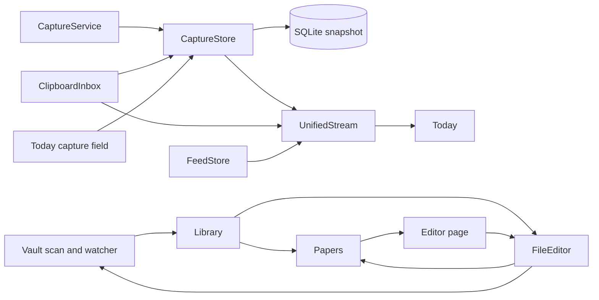

# Architecture

Piper is a Swift package. Model code lives in modules under `Sources/Modules`. The `Piper` application target sits above them and holds the windows and views. AppKit owns the windows. SwiftUI draws most of their content. The rules for new code are in [Coding guidelines](coding-guidelines.md).



## Modules

| Module | Responsibility | Depends on |
| --- | --- | --- |
| `CSQLite` | System SQLite, through `pkg-config` | nothing |
| `PiperCore` | `PiperError`, the frontmatter parser, `PaletteSearch`, `Site`, `URL.isWeb`, and `DataFolder` | Yams |
| `CapturesDatabase` | One versioned blob in SQLite, with compare-and-swap, and the `clipboard`, `sessions`, and `pages` tables | `CSQLite` |
| `Captures` | `Note`, `NoteTag`, `CaptureStore`, `ClipboardInbox`, `Clipboard`, `CaptureLinks`, `ReadingTime`, and edit sessions | `PiperCore`, `CapturesDatabase` |
| `Vault` | One folder: scan, read, write, and watch | `PiperCore`, Yams |
| `Agents` | `SessionRunner`, `AgentSession`, `AgentConnection` with `ClaudeCodeConnection` and `StdioAgentConnection`, the `ACP` types, `AgentProbe`, `SessionEvent`, `FolderSkill`, `SlashCommand`, `PermissionRule`, and the `SessionStorage` protocol | `PiperCore` |
| `History` | `BrowserCatalog`, `HistoryReader`, `DatabaseCopy`, `HistoryDigest`, `Decay`, and `BlockedSites` | `PiperCore`, `CSQLite` |
| `Feeds` | The RSParser port of NetNewsWire, `FeedStore`, `FeedDatabase`, `FeedFetch`, `FeedDiscovery`, `FeedMode`, and `OPMLImport` | `PiperCore`, `CSQLite` |
| `Stream` | `UnifiedStream`, `StreamItem`, `FeedRows`, `Relevance`, and `FeedStats` | `PiperCore`, `Captures`, `Feeds` |
| `Piper` | Windows, views, and app state | All modules and Yams |

`PiperCore` and `CapturesDatabase` have no dependency on another Piper module. `PiperCore` holds the rules that several modules share: the site of a link (`Site.key` is the host in lowercase without `www.`), the web link test, and the data folder. Each text that Piper copies goes through `Clipboard.copy`, which marks the copy so that the clipboard tray ignores it.

Each module has a test target with the same name and a `Tests` suffix. `PiperTests` tests the application target.

## App State

`AppModel` holds the stores of the modules and the state that the papers share. `AppDelegate` makes one `AppModel`. `AppModel` also holds two parts:

- `Library` holds the folder list, the active folder, the scan, the watcher, and the scan error.
- `FileEditor` holds the open file of the file paper, its Back and Forward history, its editor sessions, the editor page, its margin notes, pasted images, and its links.

A view or a controller takes the part that it uses. For example, `FolderTreeView` takes `Library`, and `FilePaperContent` takes `FileEditor`. `AppModel` takes one `UserDefaults` and gives it to each part, so a test can give its own suite.

### Messages and Errors

A store in a module throws its errors and returns what it made. For example, `CaptureStore.add` returns the new `Note`, and `CaptureStore.merge` returns the merged note. A store has no status text. The caller in the application target picks the words.

`Messages` in `AppModel` is the one channel for the messages of the app. `show(_:undo:)` shows a line, with an optional Undo button. `show(_:action:)` shows a line with another button, such as Send or Show. `report(_:)` shows an error. `AppDelegate` sets `Messages.present` to the toast. A test reads `Messages.last`.

Some errors happen where no caller waits:

- `CaptureStore` keeps the error that stopped its database from opening in `loadError`. `AppModel` reports it at launch.
- `CaptureStore` sends the error of an undo or a redo that cannot save to `reportUndoError`. `AppModel` sets it to `Messages.report`.
- `FeedStore` and `ClipboardInbox` take a `report` closure. Their timers and their reads report each database error through it. A failed feed read then gives an empty value.
- `SessionRunner` reports a storage error through the closure that `FolderAgents` gives it.
- `EditorPage` runs each call on the page with a completion handler that reports a JavaScript exception. `EditorPage.flush` throws, and `FileEditor.flushEditor` reports the error.
- `SiteScan` reports each browser history that it cannot read, and then scans the others.

## Windows

`AppDelegate` in `PiperApp.swift` creates each window when it first shows. It owns these windows:

| Window | Owner |
| --- | --- |
| Feed paper, reader papers, and the detached session panel | `PaperDesk`, with `FeedPaperController`, one `ReaderPaperController` for each reader paper, and `SessionPanelController` |
| Settings | `SettingsWindowController` |
| Note editor windows | `AppDelegate`, one for each note |
| Toast | `Toast`, which `AppDelegate` owns. `Messages` and `ReadingToast` show their content in it. |

The feed paper is the main window. Piper shows it at launch, and `showLibrary()` shows it with the open reader papers. `newCapture()` shows the feed paper on Today and asks `TodayView` to focus the capture field through `FeedPaperModel.composerRequest`. Window > Today (Command-1), File > New Capture (Command-N), and New Capture in the menu bar item call `newCapture()`. Closing every window leaves the app running in the menu bar.

### Commands

`Command` in `Command.swift` is the table of the app actions. Each case has a title, an optional `CommandKey`, and the menu that holds it. `AppDelegate` builds the main menu and the menu of the menu bar item from `Command.Menu.groups` and `Command.statusMenu`. The command palette lists each command where `isInPalette` is true. `AppDelegate.perform(_:)` runs a command from a menu item or from the palette. A command with a `standardAction`, such as Copy, goes to the responder chain.

`CommandKey` gives the glyph of a key, such as ⇧⌘K, and its name, such as Shift-Command-K. Views that show a key read it from the table, for example the session pill and the toast. Mark All as Read is in no menu. The list of a feed binds its key while the list shows. A test makes sure that no two commands share a key.

`CaptureShortcut` is the capture shortcut that Settings sets: Shift twice or Control-Option-Space. `CaptureShortcut(stored:)` reads the stored preference, and it reads the old value `Control-Option-C` as Control-Option-Space.

### Papers

`PaperDesk` owns the feed paper and the reader papers. `AppDelegate` makes the desk at launch, before the first scan. A paper is a `PaperWindow`: a titled window with a full-size content view, a transparent title bar, and no title bar buttons. Its background is clear, and the content clips to a rounded rectangle of 20 points. The window is larger than its paper by `PaperWindow.Metrics.shadowMargin`, and the paper draws its own shadow in that margin. The system shadow is off. A drag on the background or on the header moves the paper. `WindowDragArea` starts the drag. On a paper, its double click calls `PaperWindow.titleBarDoubleClick()`, which reads `AppleActionOnDoubleClick` through `TitleBarDoubleClick` and zooms, minimizes, or does nothing. `PaperWindow.zoom(_:)` fills the visible frame of the screen, less `screenInset`, and a second zoom restores the frame before it.

The system resize edges of the window lie at the outer edge of the shadow margin, away from the paper. So `PaperWindow` puts a `PaperResizeView` over the content, in the frame view of the window. The view takes a click only in a band on each edge of the paper, `resizeOutside` points outside it and `resizeInside` points inside it, with corners of `resizeCorner` points. The band outside the paper has a fill at an alpha of 1/255, because the window server sends no click to a clear pixel. Each part of the band sets the resize pointer of macOS. `PaperResize.frame(from:edges:delta:minimum:screen:)` gives the new frame, which keeps the minimum size and stays inside the visible frame of the screen.

`PaperWindow.cancelOperation` calls its `escape` closure, so Escape reaches the paper after the views in it.

`FeedPaperController` owns the feed paper. `FeedPaperView` draws the column of tabs on the left edge, and the sheet with the index, the list, or the folder tree. `FeedPaperModel` holds the state of the paper:

- `PaperDeskState` holds the tab, the scope, the open folders of the folder tree, the `TabColor` and the last file count of each folder, and the open file. Each change saves it to `paperDeskState` in the preferences. A key that is missing or that this version cannot read takes its default, and the other keys stay.
- `showsIndex` is true while the sheet shows the index of the active tab.
- `choose(_:)` handles a click on a tab. `pick(_:)` handles a pick on an index. `showList()` handles Escape and Back to the List.

`PaperTab.column(folders:showsAgents:)` gives the tabs. The fixed tabs come first: Today, Feeds, and Agents. Agents shows only while a folder has sessions. Then each folder of `Library.wikiPaths` has a `.folder(path)` tab, in the order of the list. The column has no limit. `FeedPaperModel.assignColors()` runs when the folder list changes. It calls `PaperDeskState.assignColors(to:)`, which gives a new folder the first free color of `TabColor.folderOrder` and forgets the colors of removed folders.

A click on a folder tab calls `Library.changeWiki(to:)`, because Piper scans one folder at a time. After the change, `Library.folderChanged` calls `FeedPaperModel`, which moves the folder tab to the new active folder. This is the one trigger that moves the folder tab. `FeedPaperModel.recordFileCount()` saves the file count of the active folder after each scan, so the other folder tabs show the count of their last scan.

`PaperTabs` draws the column as file-folder tabs, as in variant C of the mock. `FolderTabShape` is the outline of a tab. The feed paper draws the column twice: the tabs that are not active lie under the sheet, and the active tab lies over it, so it joins the paper. `TabColumn` measures the labels and the dashed + Folder tab. When the column is taller than the paper, the folder tabs show one letter. The rule reads the height of the paper as it shows, so a resize changes the tabs at once. `PaperTabs.Metrics.fill(_:)` and `PaperTabs.Metrics.edge(_:)` give the colors of each `TabColor`.

`PaperScope` is what the list shows: Today with one section or every section, Done, the articles of one feed, Sources, a folder, or the sessions of a folder. `PaperDeskState.lens` keeps the lens of Today. `FeedPaperIndex` draws the index of Today, Feeds, and Agents. `IndexEntry` lists the rows of an index that the keyboard can pick: the lens rows, the sections, and Done on Today, and Sources and each feed on Feeds. `FeedPaperModel.pick(_:)` shows a capture scope on Today and a feed scope on Feeds. `PaperTab.number(of:in:)` gives the Command number of a tab, and the Window menu reads it for Today and Feeds. A folder tab has no index. It shows `FolderTreeView`. `FolderTree.rows` flattens the tree of the active folder into rows, and it shows the rows of the open folders only. `FolderTree.action(_:cursor:rows:)` maps the arrow keys and Return to a move, an open, a close, or a file to open. `SessionList` lists the sessions of a folder under a New Session row.

The index and the list fade into each other in 0.22 seconds. When Reduce Motion is on, the change has no animation.

### Reader Papers

`PaperDesk.open(_:)` is the one way to open a paper. A `PaperItem` names the item: a note, an article, the file, a session, or a new session in a folder. A view finds the desk in the SwiftUI environment, as `paperDesk`. `FeedPaperController` and each `ReaderPaperController` put the desk there. A model reaches the desk through `AppModel.desk` or `FileEditor.desk`, which `PaperDesk` sets when the app makes it. `FolderAgents.send` and `ReaderAssistant.continueInSession` only make a draft session. The caller opens it with `open(.session(id))`.

When the reader keeps the session card in the detached panel, `open(.session(id))` selects the session and shows the panel in place of a paper. A link capture that keeps a feed article and the article are one paper. `PaperItem.identity(in:)` gives the item of that paper, and the desk, `DeskMarks`, and `PaperFrames` compare items by it. `PaperItem.keptNote(of:in:)` finds the link capture of a feed article, and `PaperItem.isArticle(in:)` tells whether a paper shows an article.

If a paper of the item is open, the desk brings it to the front. If not, `PaperDesk.frame(size:feed:screen:open:)` places a new `ReaderPaperController`. The first place is 24 points to the right of the feed paper, with its top at the top of the feed paper. Each next place of the cascade is 24 points to the right and down. A new paper takes the first place that no open paper has. After six places, the cascade starts again. The paper stays 24 points inside the screen.

`EditorPage` holds one web view, so one file paper exists. A second file replaces the first file on the same paper. When the file paper closes, the desk flushes the editor, so the last edit saves. Each change of the open file of `FileEditor` calls `PaperDesk.fileChanged(to:)`, from a list, Back, Forward, or a link in the editor. The desk then updates the "on the desk" mark of the folder tree and `PaperDeskState.selectedFile`, which the first scan opens at the next launch.

`ReaderPaper` draws a header with the actions of the item, and `NoteDetail`, `FeedArticleDetail`, `FilePaperContent`, or `SessionPane` under it. `ReaderPaperViewController` holds two hosting views: the content, and an overlay pinned to the bottom right corner. The overlay holds `SessionOverlay` only while the paper has the keyboard focus. The overlay takes the intrinsic size of `SessionPill` or `SessionCard`, so a click outside it reaches the content. A constraint keeps the overlay at most 85% of the paper height. `PaperLayout` shares the paper width between the card and the tabs. On a narrow paper, the card fits the width and sits above the tabs.

`AppModel.sessionPresentation` is the pill, the card, or the detached panel, and preferences keep it. `SessionCard` hosts `SessionPane`, and `SessionTarget` picks its folder, its session, and its context page. `SessionPanelController` shows the same card in a non-activating `NSPanel` on every Space. Its close button returns the presentation to the pill. `PaperDesk` owns the panel, and it shows or dismisses the panel when the presentation changes.

`PaperWindow.focusChanged` is the one report of the focus. It runs when a paper becomes key or stops being key, and in QA mode when a paper comes to the front. When a reader paper takes the focus, the desk sets `AppModel.actionTarget` from its item and shows the session card on that paper only. When the feed paper takes the focus, the store moves the articles that the reader finished a week ago out of Reading.

`PaperDesk.cycle()` moves the focus to the next visible paper, for Next Paper (Command-`). `PaperDesk.tidy()` moves each reader paper back to its place of the cascade.

`PaperFrames` keeps the frame of each reader paper by its `PaperItem`, in `readerFrames`, with the newest 200 frames. It keeps the frame of the feed paper apart from them, so the limit never removes it. `ReaderPaperController` and `FeedPaperController` report each move and each resize to the desk, which saves the frame. `PaperDesk.feedFrame(saved:screens:main:)` gives the frame of the feed paper: its saved frame, or its default size at the left of the main screen. `PaperDesk.frame(of:saved:screens:)` gives the saved frame of a new paper, or nil, and a paper with no saved frame takes the cascade. `PaperPlacement.clamp(_:to:minimum:)` moves a frame onto the screen that holds the most of it, or onto the first screen, and shrinks it to that screen. The feed paper and the saved reader frames pass through it. On `NSApplication.didChangeScreenParametersNotification`, the desk calls `PaperWindow.keepOnScreen()` on each paper.

### Paper Keys

Each paper has a key table: an array of `PaperKey`. A paper key has a `CommandKey`, a title, an `isOn` closure, and a `run` closure. `FeedPaperController.keys` and `ReaderPaperController.keys` build the table each time that a key comes, so each `isOn` reads the current state. `PaperWindow` gets the table from its `keys` closure.

The keys travel through the AppKit responder chain:

- A plain key goes first to the view with the focus. A key that no view takes comes to `PaperWindow.keyDown`.
- A key with Command comes first to `PaperWindow.performKeyEquivalent`, before the menus.
- The window runs the first key of the table that matches and is on. While `PaperWindow.editsText` is true, only a key with `inText` runs. `editsText` is true while a text view, a web page, or a sheet has the focus.
- Escape that no view takes comes to `PaperWindow.cancelOperation`, which runs the Escape key of the table.

The feed paper table holds these keys, in this order:

1. The index keys, while the index shows. Escape on the index shows the list.
2. The folder tree keys, while a folder tab shows.
3. The keys of the list that shows. Each list sets `FeedPaperModel.listKeys`: `TodayView`, `FeedArticleList`, and `SessionList`. A move to another scope clears them. The Today keys include the verb keys, the lens keys from `UnifiedStream.Lens.allCases`, Escape for the selection and then for the search, and the Command keys of Today.
4. Left Arrow for the index, the brackets, T, and Command and the number of each tab that no `Command` numbers.

The capture field and the search field of Today take their own keys. The capture field reads them in `textView(_:doCommandBy:)` of `CaptureEditor`, and the search field reads Escape with `onExitCommand`.

The reader paper table scrolls the Reader tab with the arrows, sends H and N to the reader page, takes K and B from `PaperKey.articleKeys`, and closes the paper with Escape. Both tables use `PaperKey.tidy` for T. While the reader page has the focus, the page reads its own keys. It sends each letter that it does not use in a `key` message, and `PaperWindow.perform` runs the letter from the table.

`Array.step(from:by:)` moves a cursor by an arrow key in each list and in the index.

`HintStrip` is a non-activating panel at the bottom of the screen. `Hint.hints` makes one hint for each title of the keys that are on in the table of the focused window. The strip adds New Capture on the feed paper and Next Paper while a reader paper is open. The desk updates the strip when the focus changes.

## Capture

`CaptureService` detects double Shift with `NSEvent` monitors. Control-Option-Space is a registered system hotkey, so the source app does not receive the keystroke.

The service records the source app and the active section before it reads Accessibility text. A serial queue reads the focused element with a 0.4-second timeout. If the selected text attribute is empty, the service uses the selected range. Secure fields produce no note.

The service then looks for a web page. It reads `AXDocument` from the focused element and the window, and `AXURL` from the `AXWebArea`. The web area is the first ancestor of the focused element with that role, or else the first web area in the window. If a web page is in front, the service also reads the window title and the text of the whole web area. The text comes from the `AXTextMarkerRangeForUIElement` and `AXStringForTextMarkerRange` attributes, which WebKit and Chromium both have, with a 1.5-second timeout.

`CaptureService.save` turns the result into a `CaptureOutcome`:

| Selection | Web page | Outcome |
| --- | --- | --- |
| The text of the highlight on the toast, or none, while the toast shows | Any | `comment`: the toast opens the note field |
| Text | Yes | `highlight`: `CaptureStore.saveHighlight` |
| None | Yes | `article`: `CaptureStore.saveArticle` |
| Text | No | `note`: `CaptureStore.add`, with the new note |
| None | No | An error, which the service reports |

`CaptureStore.article(for:)` finds a link capture by the link that `CaptureLinks.canonical` returns, so two links to one page share one capture. `NoteAnchor.normalized` collapses the white space of a browser selection, as the Reader tab does. The anchor of a browser highlight has block -1. `NoteAnchor.locate` finds the quote when the Reader tab opens. A quote can run over more than one block. In that case, `locate` searches the blocks joined with spaces. The mark stops at the end of the first block. If the article holds only a part of the quote, it tries shorter starts of the quote, down to four words.

`CaptureService` reports each failure through `Messages`, for example "Select text in another app first" when Piper is in front.

`Toast` owns one borderless, non-activating `NSPanel` at the bottom right corner of the screen. It owns the placement and the dismiss timer, and its `Toast.Metrics` hold its sizes and times. A message stays for 3 seconds, and a message with a button stays for 6 seconds. A new toast replaces the one on the screen. `ReadingToast` gives the toast its cards: a new highlight, a saved page, or the note field. Only the note field makes the panel the key window. Piper never becomes the active application, so the browser gets the keyboard back when the panel closes. `CaptureService.shownHighlight` reads the highlight on the toast, so a second capture of it asks for a note.

`CaptureStore` builds a candidate state and saves it before it replaces the current state. `Database` compares the stored blob with the last loaded blob on every save. A database error or a stale snapshot leaves the current notes as they are, and the change throws the error. See [Local storage](../concepts/storage.md).

### Undo

The app has one undo stack: the `UndoManager` that `AppModel` gives to `CaptureStore` at init. `AppModel.undoManager` returns it. A change that records undo registers its inverse on this stack. The inverse names only the notes that the change touched. It removes the notes that the change added, and puts back the notes that the change removed. It sets each field that the change edited back to its old value. The other notes and fields stay as they are, so a later change without undo survives an undo. Examples are reading progress, Claude answers, `saveArticle`, and `archiveFinishedReading`.

An undo is itself a change, so it registers the redo on the same stack. The active section is not part of an undo step. If an undo removes the active section, the section that was active before the change becomes active.

`TodayModel` puts each verb in one undo group. Done, Delete, and File also register the inverse of the read marks through `FeedStore.setRead(_:ids:)`, and the inverse of the clipboard texts that left the tray. The Undo button of `UndoToast` calls `undoManager.undo()`.

`FeedPaperController` and `ReaderPaperController` return the app stack from `windowWillReturnUndoManager`, so Edit > Undo and Edit > Redo on a paper go to it. `CaptureEditor` and `NoteTextEditor` give their text views their own `UndoManager`, so typing undo stays in the field.

The capture field of Today reads `# Name` alone on one line as a section, through `CaptureDraft`, and calls `CaptureStore.chooseSection`. Every other text goes to `CaptureStore.add` as it is. Capture Clipboard in the menu bar item and in Settings calls `AppModel.captureClipboard`.

`ClipboardInbox` polls the pasteboard and keeps the 50 latest texts from the last 7 days, with the copy time and the app in front. It stores them in the `clipboard` table through the `Database` of `CaptureStore`. `ClipboardInbox.save` keeps a text as a kept note in Inbox. `dismiss` removes a text for Done, and `restore` puts it back for Undo. Today shows the texts in its tray.

## Today

`UnifiedStream` in the `Stream` module joins the captures of `CaptureStore`, the texts of `ClipboardInbox`, and the articles of `FeedStore` into one read-only list. It owns no data. Each row is a `StreamItem`. Its `Ref` names the store of the item: a note, an article, a digest of one feed on one day, or a clip. The state of an item is new, reading, kept, or done. A capture is kept when it has the `kept` tag or child notes.

The stream drops an article when a capture holds its link, so a kept article shows as one row. It also drops an article older than 7 days. A section scope shows no articles. A search gives each matching article its own row. The lens filters the rows: All, Notes, Reading, or Kept. All groups the rows as Continue Reading and the days. Reading groups them as Continue, Up Next, and Finished This Week. `UnifiedStream.done` groups the done captures by the month of `modifiedAt`.

`FeedRows` turns the new articles of each feed and day into rows by the `FeedMode` of the feed. A busy day has more than 3 articles from one feed. On a busy day, Best gives an article row to the 2 best articles at or above `Relevance.bar`. The other articles go into one digest row. `Relevance` scores an article from 0 to 1 with local data only. The score uses the keep rate of the feed from `FeedStats`, and the visits to its site from the history suggestions. It also uses the words that the title shares with the file names of the active folder. It sends no request.

`TodayModel` in the application target holds the list of Today (`TodayList`), the counts, the selection, the search, the Undo offer, and the File list. It builds the stream again only when an input changes: the `revision` of `FeedStore`, `CaptureStore`, and `ClipboardInbox`, `Library.filesRevision`, the read articles that stay in the list, the lens, the scope, the search, or the day. The views and the keys read the list, so a key press runs no SQLite query. `UnifiedStream.Counts` is the one definition of the counts: the lens row, the Today tab, and the Today index read it. An opened article stays in the list, read, until `TodayModel.resetKeeping()` runs when the list shows again or the scope changes. Its verbs act on `StreamItem` values: `keep`, `done`, `file`, `send`, `ask`, `merge`, `copy`, and `delete`. Done and Delete offer Undo for `TodayModel.undoSeconds`. See [Undo](#undo). `TodayView` draws the capture field, the lenses (`SegmentedCapsule`), the groups, the tray, `UndoToast`, and `SelectionBar`. `TodayRow` draws one row through `PaperRow`, with the verb buttons on the selected row and on the row under the pointer. `PaperRow` combines the mark, the text, and the time into one accessibility element, and keeps each action a separate button. `FilePicker` lists `FileTarget` values: sections, folders, and the Markdown files of the active folder. `PiperTheme.listTitle` is the title style of every list row.

`CaptureDraft` sorts the text of the capture field. A web link alone is a link and becomes a kept link capture. A site home page or a feed address is a source and opens Sources, unless the reader presses Option-Return.

`NoteDetail` shows a link capture in its tabs and any other note in an editor. `SessionTarget` reads the open note from `AppModel.actionTarget`. For a note, the card shows the selected session when it belongs to the note, or else the newest session of the note, and it leaves out the margin sessions. A message from the card starts a session with the `noteID` of the note. `AppModel.newSessionNote` keeps the card empty after New Session. The child notes of an article stay hidden until the reader opens them.

## Agent Sessions

`FolderAgents` in the application target holds the agents, the defaults of a new session and of a margin answer, the added folders that have skills, the default folder, and the default skill for links and for text. `AppModel` refreshes the folders when the folder list changes and on each scan.

`SessionRunner` in the `Agents` module owns every `AgentSession`. Each session is an `@Observable` object, so a view of one session redraws only when that session changes. A session records its agent, its purpose, its model, its mode, and the ACP session id in `resumeToken`. `SessionRunner.config(for:)` gives the agent, the model, and the mode that a session uses. For Claude Code, it fills a model or a mode that the session leaves open with `SessionRunner.model` and `SessionRunner.permissionMode`. `FolderAgents` reads and writes these settings on the runner, and keeps them in the preferences. A stored session that does not decode stays in the database, and the runner reports it.

The runner reads only Agent Client Protocol (ACP) v1 terms. Each session has one `AgentConnection`, and the connection sends `AgentEvent` values to the runner:

| Event | Effect |
| --- | --- |
| `ready` | Stores the session id, the modes, and the config options of the agent |
| `update` | Applies one `session/update`: a part of a message, a tool call, a change to a tool call, the commands, the mode, the options, or the usage |
| `permission` | Adds a request. The session changes to `needsYou`, and the approval drawer shows the options of the agent. |
| `turnEnded` | Adds a result block with the time, the cost, and the failure, and ends the turn |

Each connection type tells the runner what the agent supports: `localCommands` take no context items, `readsDenialMessage` keeps a reply to a card in the same turn, `answersQuestions` allows `answer`, and `hasReadOnlyMode` tells whether a margin session can run. A tool call and a request carry neutral fields: `kind`, `isQuestion`, the path, and the diffs. Only `ClaudeCodeConnection` knows the tool names of Claude Code. A Claude Code session that an older Piper stored gets these fields from `ClaudeCodeConnection.completed` when it loads.

Parts of a message in a row join into one text block. A tool call keeps its ACP kind, and the transcript folds the calls of a finished turn by kind. A path stays only for a call that writes a file inside the folder.

### Connections

`ClaudeCodeConnection` runs Claude Code with no adapter. It starts one `AgentProcess` with this command in the folder:

```
claude -p --input-format stream-json --output-format stream-json --verbose \
  --permission-prompt-tool stdio --permission-mode <mode> [--model <model>] \
  [--tools <tools> --allowedTools <tools>] [--resume <id>]
```

The mode is `auto` and the model is `sonnet` by default. `ClaudeCodeConnection.models` lists the models, with `defaultModel` and `defaultMarginModel`. An empty model omits `--model`. A margin session adds `--tools` and `--allowedTools` with `Read,Grep,Glob,WebSearch,WebFetch`, and `--strict-mcp-config`. `--tools` limits only the built-in tools, so `--strict-mcp-config` removes the MCP servers of the user settings. The process then has no other tool. Claude Code takes a new model or mode only at start, so the runner closes an idle process after a change.

Each message is one JSON line on standard input: `{"type":"user","message":{"role":"user","content":[{"type":"text","text":...}]}}`. Each `ContextItem` goes after the text as a `Context file: <path>`, `Context link: <url>`, or `Context note:` line. A slash command takes the path, the address, or the note text as its argument. A transcript stores each item as one string: the path, the address, or `note:` and the text. `SessionPane` takes the item on the screen from `SessionTarget.screenItem`, and `AgentSession.sharedContext` tells it whether the session already has the item.

`SessionEvent.parse` reads each line of standard output, and the connection turns it into ACP:

| Line | Event |
| --- | --- |
| `system` with subtype `init` | `ready` with `session_id`. The slash commands become a commands update. |
| `assistant` text | An agent message. A second text in one turn starts a new paragraph. |
| `assistant` tool use | A tool call with the kind of the tool. `Write`, `Edit`, `MultiEdit`, and `NotebookEdit` record the file. `Edit` records its diff. |
| `user` with a `tool_result` | A change of the tool call to completed or failed |
| `control_request` with subtype `can_use_tool` | A permission request with Allow Once, Always in the folder, and Deny. `AskUserQuestion` is a question. `Edit` and `Write` give their diffs. |
| `result` | `turnEnded` with the time, the cost, and the failure |

A message from a subagent carries a `parent_tool_use_id`, and the parser skips it. A request sends one `control_response` line with the `request_id`. Allow sends `{"behavior":"allow","updatedInput":<input>}`. Deny sends `{"behavior":"deny","message":...}`, and Claude Code reads the message as the tool result. An answer to `AskUserQuestion` adds `answers`, a map from each question to the chosen labels, to `updatedInput`. A message that the reader sends while a request waits becomes the deny message of each waiting request, so Claude Code reads it in the same turn. Always also writes the rule from `PermissionRule` into `.claude/settings.local.json`. If that file exists and cannot be read, the write fails and the file stays as it is. The connection then allows later calls with that rule in the folder for the rest of the launch.

A turn fails when `is_error` is true, when the subtype is not `success`, or when `permission_denials` names a call that the reader did not deny.

`StdioAgentConnection` runs a command that speaks ACP, as JSON-RPC 2.0 with one message on each line. It sends `initialize` with no file system and no terminal capability, so the agent uses its own tools. Then it opens the session:

- `session/load`, for a known session id when the agent offers `loadSession`. The connection skips the history that the agent replays.
- `session/resume`, for a known session id when the agent offers only `resume`.
- `session/new` in all other cases, or when a load fails.

A prompt waits until the session opens, and goes out as `session/prompt`. The `stopReason` of the response ends the turn. Stop sends `session/cancel`, and each request that waits gets the outcome `cancelled`. A request for a method that Piper does not offer gets the error `-32601`.

The connection changes the mode with `session/set_mode`, and the model with `session/set_config_option`. An agent that sends the older `models` list in place of a model option gets `session/set_model`. OpenCode 1.2 does this.

A margin session of an ACP agent shows no request. The runner allows a call of the kind `read`, `search`, `fetch`, or `think`, and denies every other call.

`AgentProcess` reads both pipes with a `readabilityHandler`. A blocking read holds a thread for each idle process, and a few idle sessions then hold every thread of the pool. Piper ignores SIGPIPE, so a write to a process that exited fails without a crash. The process starts through `zsh -l`, so it gets the PATH of the login shell, and a command can be a name on that PATH.

`AgentProbe` checks the health of each agent for Settings. For Claude Code, it runs `claude --version` and `claude auth status`. For an ACP agent, it sends `initialize` and reads the answer. Each check stops after 10 seconds.

### Turns

At most two sessions are in a turn. Other turns wait. A timer stops a turn after 10 minutes of work. The timer stops while a request waits. After a turn, the process stays open for the next message. It ends on Stop for Claude Code, on a failure, on Delete Session, on a change of the model or the mode of Claude Code, or when Piper quits. Then the next message starts a new process that resumes the session.

The session composer handles Return, Tab, the arrows, and Escape in `textView(_:doCommandBy:)` of `CaptureEditor`. An `NSEvent` monitor kept the view from its first appearance, and Return then sent to an old session.

`SkillTarget` names what the reader paper with the focus shows: `page(path)`, `text(text, noteID)`, or `folder`. `PaperDesk` sets `AppModel.actionTarget` when a reader paper takes the focus, and the session card takes a page as context. A Send action opens a session draft with the skill command and note text. The composer sends the edited draft when the reader presses Return.

`SessionRunner` stores each session at each change of state through a `SessionStorage`. The app makes `Database` conform, so the sessions go in the `sessions` table of the note database. Quit asks before it stops sessions in a turn. `AppDelegate` also stops them on SIGTERM, because a child process keeps running after its parent exits.

## Vault

`Vault` lists every file and folder under the root and applies no rule about structure. `VaultFile` holds the path, size, modification date, text, and parsed frontmatter. `VaultWatcher` takes a `Vault`, wraps `FSEventStream` on a private queue, and calls back on the main queue.

`Vault(path:)` is the one place that turns a folder path into a root. It expands a tilde, standardizes the path, and resolves symbolic links. Two paths to the same folder give the same root. `Vault.defaultPath` is the folder that Piper uses when the reader has chosen none.

Each read and write of a folder file goes through `Vault`: `read` and `write` for bytes or text, `file` for a `VaultFile`, and `freeName` for a new file name that no file has. `VaultFile.isMarkdown` is the one test for a Markdown file.

`Library` stores the folder list and the active root in preferences. `removeWikiFolder` moves the active root to another folder before it removes a root.

`Library` starts the watcher with the first scan and replaces it when the active root changes. A scan runs in the background. A change during a scan requests one more scan. A failed scan keeps its message in `Library.scanError`, and the folder tree shows this message in place of the file list. After each scan, `Library` calls its `LibraryDelegate`, which is `FileEditor`. `FileEditor` keeps unsaved edit sessions and updates clean editors and previews. Before the active root changes, `Library` asks `FileEditor` to save each edit. See [Wiki files](../concepts/files.md).

## Reading And Editing

`FilePresentation` decides how the file paper shows a file. Markdown opens in the editor, other text in a read-only text view, and everything else in Quick Look. `FileEditor.showsFileSource` holds the choice of the Source tab. For Markdown, Source is the source mode of the editor. For HTML, it is `PlainTextPreview`.

### The Editor Page

The Markdown editor is the editor of Hubble.md, a Tiptap and React editor, in a `WKWebView`. `web/` holds its source:

- `web/vendor/hubble/` is a copy of `packages/editor` and `packages/ui` of Hubble.md. Its `README.md` names the source commit and the local changes.
- `web/src/` is the host: the bridge, the image and embed nodes, the loss guard, and the theme of Piper.
- `make web` builds one file, `Sources/Piper/Resources/editor.html`, with the JS and CSS inline. The repository holds this file. The build also writes `Licenses/Editor.txt`.

`EditorPage` owns one web view for the file paper. A change of file sends a new `open` call to the same page, so the page loads once. `EditorPane` moves the web view into the file paper. Piper calls the functions on `window.piper`, and the page sends messages to the `editor` handler, which answers each message:

| From Piper | Effect |
| --- | --- |
| `open` | Shows a file, with its full text, its mode, the byline, and the link targets. |
| `replace` | Puts the disk text into the open file with no undo step. |
| `header`, `theme`, `scrollTo`, `command`, `assetChanged` | Change the byline, the reading theme, the scroll position, run Find, and reload an embed. |
| `setNotes` | Draws the margin cards of the file. |
| `flush` | Returns the current text, for quit and Command-S. |

| From the page | Piper does |
| --- | --- |
| `change` | `FileEditor.editorChanged` saves the text. |
| `link` | Opens a wiki link or a URL. |
| `image` | Writes a pasted image to `<note>.assets/` and answers with its path. |
| `lossy` | Sets `EditorSession.lossy`. |
| `note`, `ask`, `explain`, `define`, `followup`, `continue`, `capture`, `open`, `copy` | `FileEditor.performFileAction` runs the action of the selection bar or the card. |

`AssetSchemeHandler` serves the files of the folder at `piper-asset://folder/<path>`, for images and embeds, through `Vault.containedURL`. An HTML file gets a `sandbox` content security policy, and the iframe has no `allow-same-origin`.

`Footnote.ts` adds the `footnoteReference` and `footnoteDefinition` nodes. The Hubble parser and writer in `web/vendor/hubble/editor/` read and write them as `[^label]` and `[^label]: text`. A note with more than one block indents each later line by 4 spaces.

`ReaderLayer.tsx` ports the selection bar and the margin cards of `reader.html` to the editor page. A highlight is the `highlight` mark, which `HighlightMarkdown.ts` reads and writes as `==text==` or `<mark class="color">`. The other actions go to `FileEditor.performFileAction`, which calls `ReaderMarks.perform` with a page note for the file (`FileEditor.fileLink`). `FileEditor.fileNotes` sends the cards to the page through `setNotes`.

`lossGuard.ts` parses a file, writes it back, and compares the text, the link targets, and the structure. If they differ, or the file has link titles or table alignment, the rich editor is read-only. `EditorBanner` then offers the Source tab.

### Saving

`EditorSession` holds one Markdown file: its baseline, the editor text, its status, and its revision. `DiskChange.classify` compares the baseline, the editor text, and the disk text. `FileEditor.editors` keeps the session of the open file, and each session with text that is not on disk. The page sends the last edit of a file after it opens the next file, so a session stays until that edit saves. A scan calls `EditorSession.diskChanged` for each file that changed. A conflict stops saves, and `EditorBanner` offers Reload or Keep Mine. `FileEditor.settleEditors` saves each session before a folder change and before quit. It stops on a conflict.

The editor adds an empty paragraph after a last block that is not a paragraph, so that the reader can type under it. `tiptapDocToMarkdown` does not write this paragraph. `EditorView` adds the final newline that the file had. A file that opens with no edit then saves with no change.

### Command Palette

`CommandPaletteController` shows `CommandPaletteView` in a borderless child panel of the paper with the focus, or of the feed paper. `PaletteResults` ranks files with `PaletteSearch.score` and finds lines with `PaletteSearch.excerpts`, off the main thread. The scores copy `fuzzy.ts` of Hubble.md.

`WikiWorkspace` owns the navigation history. `WikiLinks` resolves links. `WikiMarkdown` parses the blocks of a file for the margin agent.

## Link Reader

`NoteDetail` shows a capture. `CaptureLinks` finds HTTP and HTTPS URLs with `NSDataDetector` and keeps the original text. If the capture is only a URL, the reader opens it at once. `AppModel.articleTab` picks the Reader tab, the Web tab, or the Notes tab. `AppModel.chooseArticleTab(_:for:)` records a choice of Reader or Web for the site of the link, and `AppModel.openingTab(for:)` opens the next link of that site in the same tab. A link from a new site opens in the Web tab. `NoteDetail` shows Reader, Web, and Notes in a `TabIsland` at the bottom of the paper.

`NoteWebReader` embeds `WKWebView` through `NSViewRepresentable`, which works on macOS 14. It keeps the requested URL apart from the current URL, so a view update does not restart navigation after a redirect. A new capture selection resets the reader.

`ArticleReader` shows the Reader tab. `ArticleLoader` loads the page in a `WKWebView` outside the window and runs a script in an isolated content world. The script prefers an article container over the main page container. It returns headings, paragraphs, list items, quotes, code blocks, images, videos, video frames, and tables. An image or a video keeps its address and the caption of its figure. A lazy image gives the address in its data attribute. A table of text is a `table` block. A table that holds paragraphs or images is a page layout, so the script reads the blocks in it. Only the text and the captions are text nodes in `reader.html`, so the offsets of the marks still match the block text. The content security policy of the page allows remote images and media. If it finds no structured blocks, it splits the container text at blank lines. The article stays in memory for the rest of the launch.

`CaptureStore.pageText` returns the page text that a browser capture kept in the `pages` table. `ReaderArticle(url:title:pageText:)` turns each line of 40 characters or more into a paragraph. `ArticleLoader` uses that article when the load fails, or when the kept text has more than 2.5 times the words of the loaded article.

A second `WKWebView` loads `Resources/reader.html`, which allows no network requests. Piper calls `window.piper.render` with the article and `window.piper.setNotes` with the child notes. The page draws the text with `textContent`, so page markup never runs. Each action of the reader comes back through the `piper` message handler. The page draws the article again only when a mark changes, so an answer does not clear a selection.

The page reports the first block on the screen and the progress 250 milliseconds after a scroll stops. `ArticleReader` saves them in `Note.reading` 800 milliseconds later, through `CaptureStore.updateReading`, with no undo step. At a progress of 0.97, it records the finish time. When the article loads, `ArticleReader` records the title, the reading time, and the open time. It then picks the first place: a `ReaderScroll` request for this capture, the saved block, or the newest highlight from another app. A `ReaderScroll` names its capture, so a request for one article does not scroll another.

`ReaderAssistant` in `AppModel` saves highlights and questions as child notes, through `CaptureStore.addChild`. A highlight with a note of the reader is a `note` on the page, which draws it as a plain card. `HighlightText.comment` reads that note from the text after the quote. `NoteAnchor.locate` finds the quote of each note in the current article. One `AgentSession` answers the questions of one capture. Its `noteID` is the first question note. The assistant sends one message at a time and watches the session with `withObservationTracking`. When the turn ends, it appends the result text to the question note. Each answer thus stays after its own message in the transcript.

The Capture button runs JavaScript in an isolated content world. One call returns the selected text or the page text, the title, and the URL. `CaptureStore` saves the result to Inbox.

`ReadingList` in the `Captures` module groups the link captures that are not done into Continue, Up Next, and Finished This Week. `Note.isArticle` is true for a capture without a parent that has a reading state or holds only a link. `UnifiedStream` reads `ReadingList`. At launch, `AppModel` marks as done each article that the reader finished more than seven days before.

`ArticleNotebook` shows the Notes tab. Its summary is a child note with the tag `summary`. `ArticleMarkdown` builds the file of Save as File, and the text that Update File adds. `Vault.write` writes the file, and `Note.reading` records its path and the save time.

`Info.plist` sets `NSAllowsArbitraryLoadsInWebContent`, so WebKit can load HTTP pages. Other network requests keep the default App Transport Security policy.

## Search

Today search filters the captures, the articles, and the clipboard texts of the scope. Go to File (Command-K) searches every file of the active folder. See [Command Palette](#command-palette).

## Feeds

`FeedStore` owns the feeds and their articles. It keeps them in `Feeds.sqlite` through `FeedDatabase`. See [Local storage](../concepts/storage.md#feeds).

The parser in `Sources/Modules/Feeds/RSParser` is a copy of the RSParser of NetNewsWire. It reads RSS, Atom, RSS-in-JSON, JSON Feed, and OPML. Its `README.md` names the upstream commit and lists the local changes.

A refresh has these steps:

1. A timer in `FeedStore` runs every 60 seconds. It takes each feed whose `nextFetch` is in the past.
2. `FeedFetch.get` sends a conditional GET with the stored ETag and Last-Modified values. Up to 4 requests run at the same time.
3. A 304 answer changes nothing. A new body goes to the parser, and `FeedFetch.articles` makes one `Article` for each item. The id of an article is the MD5 of the feed address and the unique id of the item.
4. `FeedDatabase.insert` ignores an article id that exists, so a refresh keeps the read marks.
5. A success sets `nextFetch` to 30 minutes later. Each failure in a row sets a longer wait, from `FeedFetch.waitHours`.

After each refresh, `FeedStore` prunes the read articles that arrived more than 30 days ago.

`FeedDiscovery.find` takes the address of a site or a feed. If the address is a feed, it returns that feed. If not, `HTMLFeedFinder` reads the feed links of the page. `find` parses the 3 best candidates to confirm them.

`OPMLImport` reads an OPML file and returns each feed, also the feeds in folders. `OPMLImport.netNewsWireFile` is the OPML file of the On My Mac account of NetNewsWire.

`FaviconStore` finds the icon of each host. It reads the icon links of the home page with `HTMLMetadataParser`, then tries `/favicon.ico` and the Apple touch icons. It keeps the first answer that ImageIO reads as an image, as a file in `Favicons/`. A view calls `icon(for:)` while it draws, so the store loads the icon in a task and `icons` changes later. A host with no icon waits for the next launch. `SiteIcon` draws the icon.

`SourcesView` lists the feeds with their `FeedStats` and their `FeedMode`, adds a feed with `FeedDiscovery`, imports OPML, and shows the history suggestions. `FeedArticleList` fills the list of one feed. A click, Return, or Space opens an article on a reader paper. `FeedArticleDetail` shows the article. If the article is a link capture, it shows `NoteDetail` for that capture. If not, it shows `ReaderPageView` and `NoteWebReader` under the same `TabIsland` as `ArticleReader`. The header of the article paper has Keep. `AppModel.keep(_:)` keeps articles for Today, the feed list, and the article paper. `FeedStore.revision` changes after each write, so the views read again.

## History Scan

`SiteScan` in the application target runs each scan. Sites You Read Often on Sources shows the result. A scan has these steps:

1. `BrowserCatalog` finds each history source. `HistoryReader` reads a private copy of each database through `DatabaseCopy`, so another app cannot lock the file and the original does not change.
2. `HistoryDigest` ranks the sites of the last 14 days with `Decay`. The points of a site are its visits, and the age is the time since the last visit. It drops blocked sites and private hosts, and it keeps 30 sites at most.
3. `FeedDiscovery.find` loads the home page of each site, 4 sites at a time.
4. `FeedStore.replaceSuggestions` writes one `Suggestion` for each site, with its feed or with no feed. The rows that you ignored stay.

`SourcesView` calls `SiteScan.scanIfStale` when it shows. A scan starts if the last scan is older than one day. The scan sends no data to an agent.

## QA Mode

A debug build that starts with `-PiperQA YES` is in QA mode. A test uses QA mode to drive Piper while the user works in another app.

- `QA.activate` replaces `NSApp.activate`, so Piper never becomes the active app.
- `QAScripts` runs JavaScript in the editor page. A test posts the distributed notification `com.piper.qa.eval` with the body of an async function. Piper writes the result to the file that `-PiperQAResult` names.
- The distributed notification `com.piper.qa.do` runs one command on the papers: `capture`, `key`, `focus`, `open`, `reader`, `appearance`, or `shot`. The `key` command sends a key event to the paper window with the focus. The `shot` command draws the feed paper window into a PNG file, which works while the screen is locked. See `QAScripts` for the syntax.
- In QA mode, `PaperKey.focusedWindow` is the paper that QA gave the focus, because Piper has no key window while it is not active.

macOS sends keys only to the active app. Thus a test in QA mode inserts text with a script, not with keys. A release build has no QA mode.

## Source Map

| Source | Responsibility |
| --- | --- |
| [PiperApp.swift](../../Sources/Piper/PiperApp.swift) | `AppDelegate`, menus, the menu bar item, editor windows, the toast, and quit |
| [Command.swift](../../Sources/Piper/Command.swift) | `Command`, the table of app actions with their titles, keys, and menus, and `CommandKey` |
| [AppModel.swift](../../Sources/Piper/AppModel.swift) | The container of the stores, `Library`, and `FileEditor`, with the state that the papers share |
| [Library/](../../Sources/Piper/Library) | `Library` (the folder list, the scan, and the watcher) and `FileEditor` (the open file, its history, its editor sessions, the editor page, its margin notes, and its links) |
| [AppDefaults.swift](../../Sources/Piper/AppDefaults.swift) | The preference keys |
| [PiperTheme.swift](../../Sources/Piper/PiperTheme.swift) | The shared colors, fonts, type sizes, and the dark appearance test. Each feature keeps its own sizes, times, and colors in a `Metrics` enum next to its views. |
| [SharedViews.swift](../../Sources/Piper/SharedViews.swift) | `IconButton`, `Rule`, and `EmptyPane`, which views in several folders use |
| [FileReadState.swift](../../Sources/Piper/FileReadState.swift) | Read timestamps for each file |
| [CaptureService.swift](../../Sources/Piper/CaptureService.swift) | `CaptureShortcut`, global shortcuts, Accessibility selection, and web page capture |
| [Messages.swift](../../Sources/Piper/Messages.swift) | `Messages`, the one channel for messages and errors |
| [Toast.swift](../../Sources/Piper/Toast.swift) | `Toast`, the one panel that shows messages and the cards of a web page capture |
| [ReadingToast.swift](../../Sources/Piper/ReadingToast.swift) | The cards of a web page capture and the note field |
| [ReaderAssistant.swift](../../Sources/Piper/ReaderAssistant.swift) | `ReaderArticle`, highlights, notes, and Claude questions of the Reader tab |
| [FolderAgents.swift](../../Sources/Piper/FolderAgents.swift) | Folders with skills, default skills, and every send action |
| [AgentViews.swift](../../Sources/Piper/AgentViews.swift) | The session badge, the Send button, and the skill list |
| [Sessions/](../../Sources/Piper/Sessions) | The session pane, the transcript views, the cards, the message field, the session card, and the detached session panel |
| [SendShortcut.swift](../../Sources/Piper/SendShortcut.swift) | The system hotkey of Send Clipboard |
| [Modules/Agents/](../../Sources/Modules/Agents) | Skill discovery, command parsing, sessions, the JSON stream, allow rules, and the session runner |
| [Today/](../../Sources/Piper/Today) | `TodayModel`, `TodayView`, `TodayRow`, `FilePicker`, and `SegmentedCapsule` |
| [CaptureRows.swift](../../Sources/Piper/CaptureRows.swift) | `RowTime`, and the section and note sheets |
| [CaptureEditor.swift](../../Sources/Piper/CaptureEditor.swift) | The composer text view |
| [Papers/PaperDesk.swift](../../Sources/Piper/Papers/PaperDesk.swift) | The one way to open a paper, the feed paper, the reader papers, the session panel, their placement, and the focus |
| [Papers/PaperFrames.swift](../../Sources/Piper/Papers/PaperFrames.swift) | The saved frames of the feed paper and the reader papers, the rules that keep a paper on the screen, and the double-click setting |
| [Papers/PaperDeskState.swift](../../Sources/Piper/Papers/PaperDeskState.swift) | `PaperTab`, `PaperScope`, and the restored state of the feed paper |
| [Papers/](../../Sources/Piper/Papers) | The feed paper, its tabs, its index, its lists, the reader papers, and the row icons |
| [Feeds/](../../Sources/Piper/Feeds) | The article list, the article detail, Sources, the history scan, and the Feeds settings |
| [Modules/Feeds/](../../Sources/Modules/Feeds) | The parser, the feed database, refresh, feed discovery, and OPML import |
| [Modules/History/](../../Sources/Modules/History) | History sources, history reads, the digest, the decay rank, and blocked sites |
| [Readers/](../../Sources/Piper/Readers) | File previews, the Reader tab, the Web tab, the Notes tab, and the tabs at the bottom of a paper |
| [Modules/Captures/ReadingList.swift](../../Sources/Modules/Captures/ReadingList.swift) | The Reading groups and the Markdown of Save as File |
| [Modules/Stream/](../../Sources/Modules/Stream) | The stream of Today, the feed rows, and the relevance score |
| [Readers/EditorPage.swift](../../Sources/Piper/Readers/EditorPage.swift) | The editor page, its bridge, the asset scheme, and the conflict bar |
| [EditorSession.swift](../../Sources/Piper/EditorSession.swift) | The save of a Markdown file and the conflict rules |
| [CommandPalette.swift](../../Sources/Piper/CommandPalette.swift) | The command palette |
| [ReadingAppearance.swift](../../Sources/Piper/ReadingAppearance.swift) | Reading themes, fonts, and appearance, and `ReadingSettings`, the four reading preferences with their defaults |
| [web/](../../web) | The source of the editor page |
| [WikiWorkspace.swift](../../Sources/Piper/WikiWorkspace.swift) | Navigation history and link resolution |
| [WikiMarkdown.swift](../../Sources/Piper/WikiMarkdown.swift) | Block parsing and heading anchors |
| [Wiki.swift](../../Sources/Piper/Wiki.swift) | The whole text of a file |
| [SettingsWindow.swift](../../Sources/Piper/SettingsWindow.swift) | The Settings window and its panes |
| [QAHooks.swift](../../Sources/Piper/QAHooks.swift) | QA mode: no activation, and scripts in the editor page |

